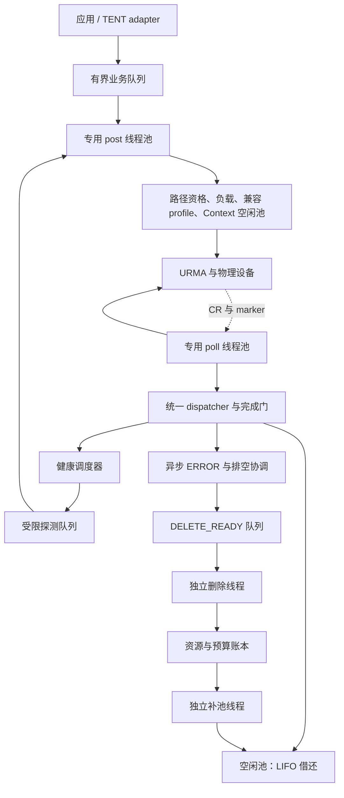
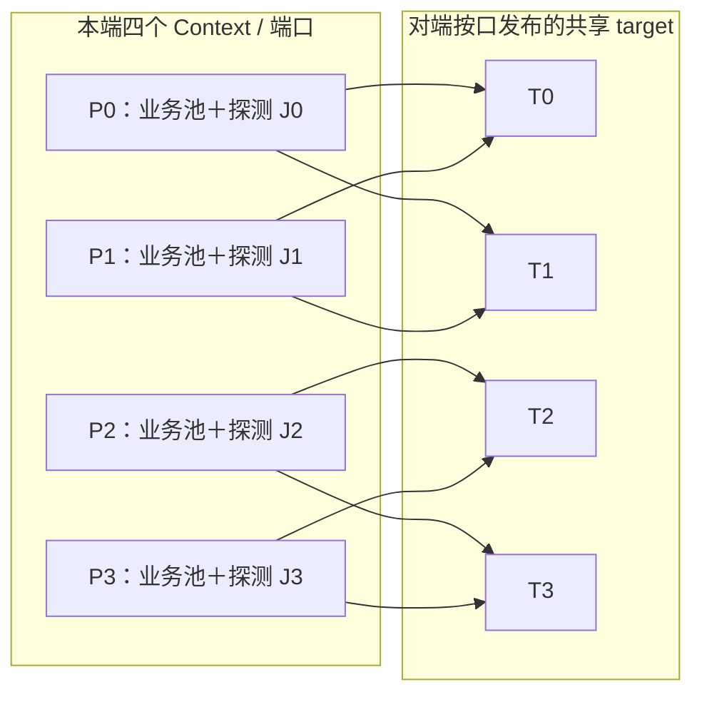
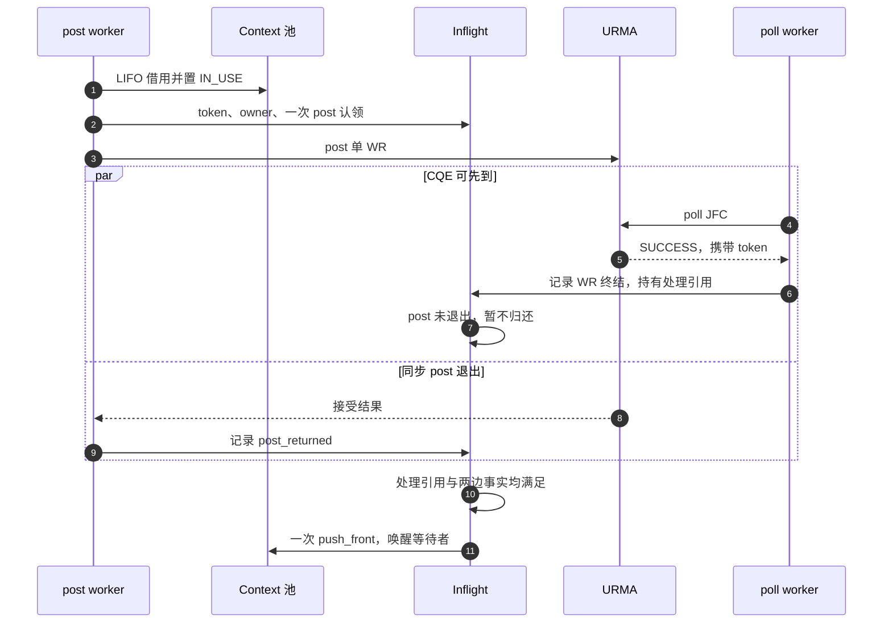
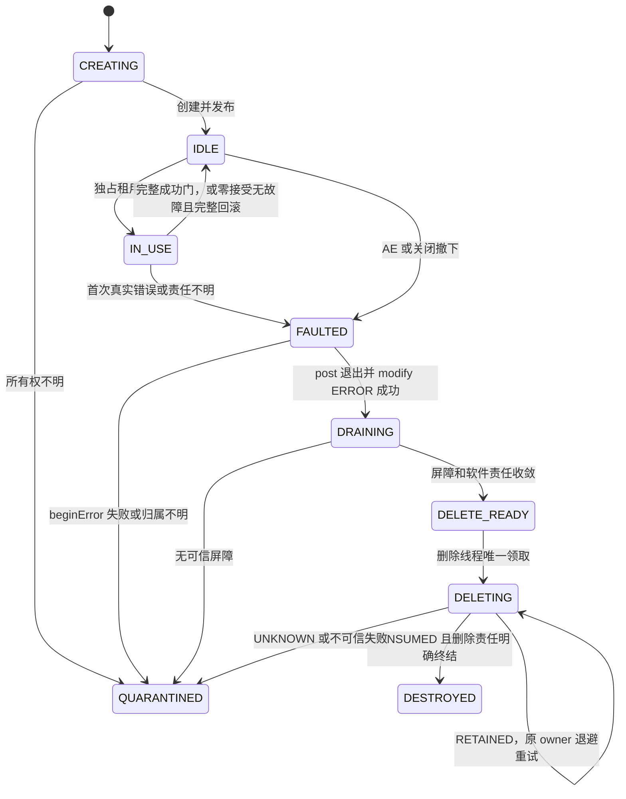
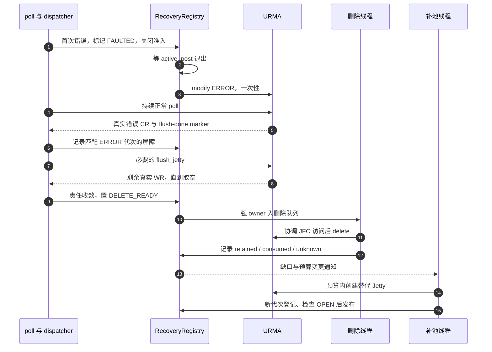
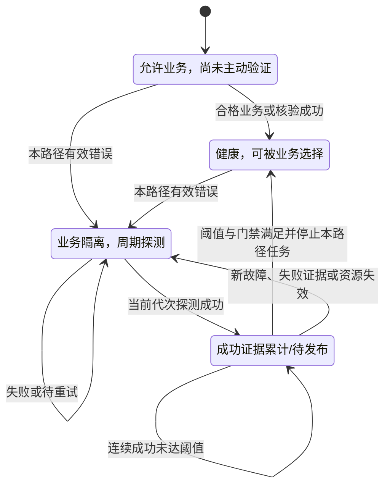
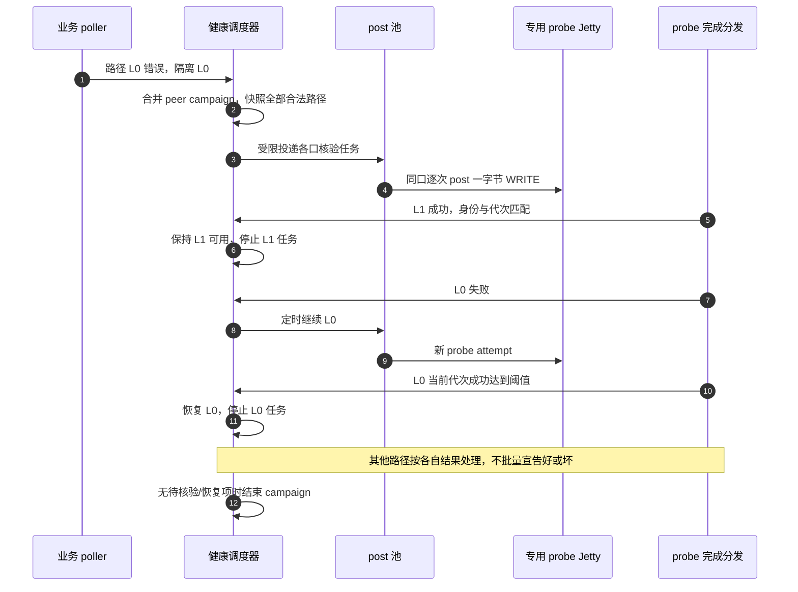
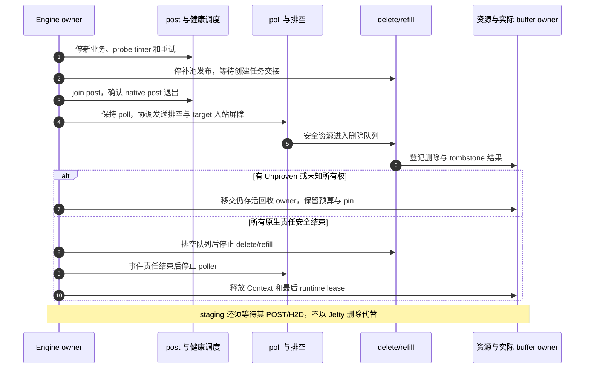

# TENT 物理 UB RM Jetty 池化与链路探测统一设计（V4）

> 日期：2026-11-10（本次基线复核）。
>
> 输入基线：本文整合 `tent-ub-rm-jetty-pool-design.md`（V3）的全部明确设计细节，以及原基准文档中的 DeviceKind、RM adapter、bootstrap v2、迁移门禁和工程实施路线。原始 `supercache_jetty_pool_current_and_target.md` 保持不变。
>
> 源码基线：Mooncake `tent/tent_rm`，HEAD `e1d39c4d`（父提交 `0d3463c0`）；工作树另有 `mooncake-common/FindUrma.cmake` 与本执行清单改动，以及本文档和 `.clangd` 未跟踪文件。UMDK 取构建/验收时实际解析版本；本次没有读取到可证明其 HEAD、ABI、驱动和固件组合的记录，故均不在此伪填版本号。V3 所述 UMDK `09086da5` 与旧清单中的 `965ceae8` 只作历史参考，不作为当前 provider 契约。
>
> 状态：第一步 physical RM 前置代码已完成；作者报告该步骤的自测 UT 全部通过。本次复核未取得可重放的自测命令、构建配置与逐测试报告，因此将其记为“作者自测通过”，不等同完整 CTest/CI 或真实硬件验收通过。当前生产数据面仍为 RC/bootstrap v1；RM legacy、RM 池化、生产 v2 握手、共享 target owner 和物理 UB 探测均未实现。完整 CI、provider 契约、双端 RM、实机压力与灰度验收仍是后续门禁。
>
> 范围：TENT / 独立 UbEngine 的 non-bonding physical UB、URMA_RM、CPU DRAM 单边 READ/WRITE。设备内存 staging 仍由 TENT runtime 管理。
>
> 本文统一替代两篇输入文档中相互冲突的 target 归属、探测启动与停止、错误 Jetty 归还、同步排空、删除重试、补池公式和容量配置结论；组件化、实际 buffer owner、协议校验、DMA 安全及 RM legacy 前置门禁继续适用。

## 1. 核心目标、约束与功能边界

### 1.1 核心目标

1. 将业务发送 Jetty 的创建、租用、完成归还、故障排空、异步删除和补池，从 endpoint 生命周期中解耦。
2. 节点按配置端口发布共享 RM target；本地按 Context 和远端 target 导入，endpoint、业务和探测只持引用。
3. 每个 slice attempt 独立选路、独占一个业务发送 Jetty、最多执行一次 native post 且恰好提交一条 WR。
4. 复用现有专用 post/poll 线程框架，增加独立控制、删除和补池职责；应用和 TENT adapter 不直接 native post/poll。
5. 以业务错误触发受限 peer 核验，通过专用探测 Jetty 和一字节 WRITE 恢复路径；路径恢复后停止该路径周期任务。
6. 用完整身份、代次、完成门、异步屏障、tombstone 和实际 buffer owner，防止早到 CQE、迟到事件、native ID ABA、未知 WRITE 和提前释放。
7. 先完成真实 RM legacy 基线，再启用池化；不以当前 RC 实现、自动 bonding 或静默 mode 切换作为 RM fallback。

### 1.2 强制约束

| 项目 | 统一决定 |
| --- | --- |
| 选路 | 每个 slice attempt 独立选择本地 Context/EID 和远端按口 target，不按 Group/Task 汇聚 Jetty |
| 发送池 | 每个 Context/兼容 LocalSendProfile 建池；先选路，再从对应池租用一个空闲发送 Jetty |
| WR | 池化路径每 attempt 最多一次 native post，输入恰好一条 WR；重试是新 attempt |
| 独占 | 一个业务发送 Jetty 同时只服务一个 attempt；安全归还后可顺序访问其他兼容 peer |
| 空闲顺序 | 同池 LIFO，刚归还成员优先下次使用；不改变路径选择顺序 |
| 远端目标 | 节点每个配置端口发布一个共享 target，业务与探测共同使用；endpoint 只引用 |
| 导入归属 | imported target 由本地 Context 的 Registry 持有，不归某个 probe Jetty 或 endpoint 独占 |
| 探测资源 | 每个本地端口一个专用 RM 发送 Jetty，不进入业务发送池 |
| 拓扑 | 从端口清单和合法邻接关系计算路径；每口两个邻居时，4 口为 8 路、6 口为 12 路 |
| 探测启动 | 初始化后允许 ELIGIBLE_UNVERIFIED 路径承载业务；业务错误立即隔离出错路径，并对该 peer 的配置路径集合发起受限核验 |
| 探测停止 | 当前有效成功证据满足恢复阈值和其他门禁后恢复路径，并停止该路径周期任务 |
| 错误 Jetty | 首次真实错误 CQE 对应的发送 Jetty 强制退役，不因后续探测成功回到业务池 |
| 排空 | 关闭 post 门禁，modify ERROR，持续正常 poll，识别 flush-done，再执行软件 flush 并结算剩余 WR |
| 删除 | 独立删除线程消费 DELETE_READY 队列；不能在 poll 热路径直接销毁，也不能假定 delete 失败可盲目重试 |
| 补池 | 独立补池线程恢复静态 Serving 目标；IN_USE 计入 Serving，不按 idle 缺口无限扩池 |
| 线程 | 专用 post 池和 poll 池；探测也交 post 池；delete、refill、control 和 callback 职责分离 |
| 请求限额 | K 约束单个网络 UbTask 跨 Context 的准入 attempt，不是父 staging 请求窗口 |
| 可靠性 | timeout/cancel 不等于 DMA 结束；保留实际 buffer owner、quarantine、事件归属和 Unknown 结果 |
| 性能 | 不预设 RM 池化优于 RC/bonding；必须在相同语义和 native 预算下测量吞吐、尾延迟和 CPU |

### 1.3 明确不引入

- 不引入 Group、window、producer Seal、RC 池化、原生业务 SEND/RECV/atomic。
- 不提供跨 Jetty 全局写顺序或请求原子可见性。
- 不把 `UbTask::seal` 当作 post 退出或 DMA 屏障；它只封闭 slice 集合。
- 不在池化路径保留逐 endpoint 固定 Jetty 数组、两端 Jetty 数量相等校验或 RC bind。
- 不在 poll 热路径同步等待 flush-done，不以同步 quiesce 作为缺少异步能力的池化 fallback。
- 不通过名称猜测 PHYSICAL，不把 pool 空、probe Pending、任意 CQE 或 ACK timeout 汇总成物理节点全坏。
- 不做运行中 RC↔RM、v1↔v2 或 pooled↔legacy 的原地切换。

## 2. 当前源码事实与统一裁决

### 2.1 Mooncake 当前实现边界

| 当前工作树事实 | 对目标设计的约束 |
| --- | --- |
| DeviceKind 已新增 UNKNOWN/PHYSICAL/BONDING/VIRTUAL/AGGREGATE、显式身份记录、physical_only 筛选和 openContext 二次校验 | 仅为准入脚手架；默认仍是非 physical_only，完整 CI 与真实 provider 复核未完成 |
| bootstrap v2 已将远端 profile 拆为数值 `trans_mode/target_type/tp_type`，首版只接受 RM/RTP 与 URMA_JETTY；transport_modes 使用 uint16 位图并拒绝未知位 | 远端不再携带 priority/capability_set/bind mask/policy/flag；真实 producer/consumer、trusted metadata 提交事务和 target owner 尚未接通 |
| 已新增本地 LocalSendProfile 派生，DeviceCapabilities 保存 rm_tp_cap 和 16 项 priority/tp_type 掩码；本地 priority 与 Jetty 创建均限制为 0..15 | 仅完成 adapter-neutral helper 与 native 常量 static_assert；当前生产 JFS/JFR/import 仍为 RC，不能据此宣称 RM native 数据面完成 |
| 已有 duplicate/stale/newer/conflict 比较 helper | 尚需原子 compare-and-commit；helper 存在不等于 Registry 已防止乱序覆盖 |
| 当前生产握手仍生成 v1；合法 RM v2 在 native 分配前返回 NotImplemented | 不得宣称 v2 握手或 RM legacy 已落地；该 fail-closed 行为必须保留到 RM runtime 完整实现 |
| RealJfc JFR、RealJetty JFS 和远端 import 仍硬编码 URMA_TM_RC，import 后 bind，post 要求 BOUND | 必须将已新增的两类 Profile 接入完整 RM native 路径，不能只改一个 mode 常量 |
| 现有 post/poll 两池、逐 slice 路由、Inflight 预登记和 partial-post 前缀处理可复用 | 池化路径必须改为每 attempt 单 WR；legacy 的 WR chain 只能作为独立对照路径 |
| 当前可按 endpoint 批量组成 WR chain | 不得把 legacy 批量 post 接口原样用于池化；批量计数缺陷必须先修复 |
| `tryAcquireOutstandingBatch` 对 endpoint 增加 admitted 个 WR，但 Context 只调用一次 `addInflight`，后者固定加一 | P0 必须按 admitted 修正 Context WR 计数，逐完成配对扣减；否则恢复 gate 可能提前通过 |
| 当前成功 CQE 按 slice 全长记账 | RM legacy 和 pooled 验收必须校验 `completed_bytes`/completion length 与 provider 契约一致 |
| 当前 quiesce 持 JFC poll 锁同步等待 marker，再调用 `urma_flush_jetty` | 可复用事件分类知识，不能原样搬入 poll/独立删除线程；P3 必须异步化 |
| 当前没有 SendJettyPool、共享 target owner、主动 ProbeResource、DELETE_READY 队列、RefillController 或 tombstone | 相关组件均是待实现设计，不是现有能力 |
| 默认 worker_count=6、poller_count=2、jfc_per_context=6、jetty_per_endpoint=6；slice_size=64 KiB、max_slices_per_task=65536 | 前两者是线程起点，后两者只描述 legacy；pool/probe/delete/refill 需独立预算和配置 |

当前协议/profile smoke 已覆盖 38 项轻量独立编译运行检查，另有 DeviceKind smoke；真实 UMDK 头文件下的常量 static_assert 语法检查通过。它们仍只覆盖真实仓库函数的轻量验证。完整 CMake/CTest、glog/gtest 环境、clang-format 20、pre-commit、真实 RM provider、双端 READ/WRITE、物理 fence、4/6 口和性能测试均须另行留证，不得写为 PASS。

### 2.1.1 本次代码核对记录

本次按 Jetty/RM 相关范围核对 TENT UB 的配置解析、设备发现与筛选、profile/capability、bootstrap DTO/校验/版本 gate、URMA adapter、Context/JFC、endpoint/Jetty、post/poll worker、buffer 注册与导入、错误清理，以及 `ub_core_test`、`ub_native_data_path_test`、`ub_teardown_test` 和对应 CMake 注册。结论只适用于上述物理 UB RM 前置链路，不代表逐行审阅了 Mooncake 仓库中与本特性无关的所有组件。

| ID   | 文档原表述/偏差                                                                        | 当前代码证据与修正                                                                                                                                                                          | 影响及处理状态                                                      |                                                                       |
| ---- | ------------------------------------------------------------------------------- | ---------------------------------------------------------------------------------------------------------------------------------------------------------------------------------- | ------------------------------------------------------------ | --------------------------------------------------------------------- |
| D-01 | 基线仍写 `tent/perf / 7f2d08f0`，并把 DeviceKind/bootstrap 记作未提交工作树                    | 当前分支为 `tent/tent_rm`，HEAD `e1d39c4d`；DeviceKind、RM profile、bootstrap v2 DTO 与校验 helper 已在已提交代码中。此页头和状态已改为当前分支事实                                                                    | 会影响代码审阅和复测复现；已修正文档基线                                         |                                                                       |
| D-02 | 将“轻量 smoke 通过/完整测试未完成”作为全部 UT 状态，未体现最新执行进展                                      | 用户说明第一步前置代码自测 UT 全部通过；该信息已记为作者报告。具体命令、测试清单、环境与报告仍缺，因此不推导为完整 CTest/CI PASS                                                                                                          | 避免漏记进展或夸大证据；已补充状态边界，测试 Owner 仍需归档可重放证据                       |                                                                       |
| D-03 | 容易把“bootstrap v2 已实现”读成生产握手已切到 v2                                               | `UbBootstrapDesc` v2 wire DTO、严格解码/字段校验、身份交叉校验与 generation compare helper 已实现；`UbEndpoint::makeBootstrapDesc` 仍生成 v1，生产 `onBootstrap` 以 RC 模式 gate 并在 endpoint/native 副作用前拒绝 RM v2 | 生产 v2、trusted metadata 原子提交及 target owner 仍是后续 P1 工作；正文状态已明确 |                                                                       |
| D-04 | “physical-only/可信 PHYSICAL”可能被理解为 provider 自动证明设备物理属性                           | adapter 将发现设备初始化为 `UNKNOWN`；`physical_only` 依赖管理员配置的显式身份记录匹配 name/path/EID/index/transport_modes，openContext 前还做 capability 校验。当前机制是受信配置准入，不是独立硬件证明                                | 配错/过期身份会影响准入正确性；部署需由设备/实机 Owner 管理 allowlist 并核验，列入待确认项      |                                                                       |
| D-05 | adapter 段落把后续异步排空/删除设计与当前 adapter contract 混写                                   | 当前 `UrmaAdapter` 仍提供同步 `quiesceJetty`、vector post、`posted_count` 前缀接收和 poll；header 对成功 quiesce 的 fence 语义是接口契约，不是本次新增的 RM 异步状态机实现                                                  | RM legacy 可先复用同步语义；池化错误热路径需按 P3 新增异步屏障，禁止声称已实现；已在阶段表中拆分      |                                                                       |
| D-06 | 容易把当前 endpoint/Jetty 生命周期等同于目标共享池模型                                             | 当前 `UbEndpoint::prepare/bind` 创建固定数量 Jetty，按 remote Jetty ID 数量相等并逐项 bind；本地 bootstrap 仍发布 Jetty ID/UASID 数组。共享 LocalPortTarget、ImportedTargetRegistry、SendJettyPool 均不存在          | RM legacy 迁移与 pooled 架构是两步；已明确代码现状和 P1/P2 依赖                 |                                                                       |
| D-07 | 将 UMDK master 源码观察写成可直接依赖的 provider 保证                                          | 本次没有可核验 UMDK commit/ABI/驱动/固件清单；源码观察不能证明本机 provider 并发、DMA fence 或 delete 失败语义                                                                                                     | 全部 provider 假设须经版本快照和硬件用例确认；已将未知项转为决策/证据登记，不宣称已闭环            |                                                                       |
| D-08 | 设计中的默认参数、端口示例与资源数量容易被读成当前运行配置                                                   | 现有 `UbParams` 默认 RC legacy、pool/probe 关闭；`jetty_per_endpoint` 只服务 legacy。4/6 口及 desired serving 数是拓扑/容量示例，不是可分配结论                                                                  | 生产配置需有设备账本和拓扑验收；相关示例继续标记为目标/占位，并新增 owner 确认项                 |                                                                       |
| D-09 | “物理构建不依赖 BONDP”被写成当前构建事实                                                        | `urma_adapter.cpp` 在 `TENT_HAS_REAL_URMA` 下无条件 include `urma_ubagg.h`，并保留 bonding context 的 `bondp_set_bonding_mode` 分支；物理运行时不会调用该分支，但编译仍有头文件依赖                                    | 第 6.1 节明确标为最终物理构建准出要求，而不是当前已满足事实                             | 是否拆分 BONDP 编译依赖需在 P1 处理；P0-2 需验证 CMake 的 UMDK core include 路径能否提供该头文件 |
| D-10 | 工作树 `FindUrma.cmake` 的 FetchContent fallback 跟踪浮动 `master`，与可复现 provider 基线要求冲突 | 当前未提交 CMake 改动将 fallback 用于 test/header-only 构建并要求生产安装系统 UMDK；fallback 仍不能提供固定源码快照                                                                                                 | 文档要求生产与验收使用记录 SHA/ABI 的系统 UMDK；浮动 fallback 不作验收基线            | P0-2 需固定测试 fallback 版本或明确仅本地探索用途；构建证据记录实际解析路径和 commit                 |

以上已修正的是文档与当前代码间可由仓库证据判定的事实偏差。目标架构中涉及 provider、部署拓扑、SLO 和外部 Owner 决策的内容，不能凭本地代码审阅宣布“100% 已确认”；它们单列在第 2.1.2 节，只有完成具名确认和所需实测后才能解除阻塞。

本文中关于 UDMA 对象表、flush marker、JFC 清理和 delete 失败副作用的细节，是此前针对历史 UMDK 源码版本的代码观察，不代表本次已核验版本。对照当前 provider 的实际结果前，均作为待验证假设处理，并受 B-03/B-04 门禁约束。

### 2.1.2 待沟通决策与证据登记表

仓库仅定义角色，没有负责人的姓名或可用沟通渠道。当前登记状态统一为 `待 Owner 回复`；以下为具体上下文、选项和影响，不能将建议默认值当成签字结论。待确认只阻塞相关阶段，不阻止已确定的前置代码和测试补全。

| ID / 状态 | 需确认事项与当前上下文 | 责任角色 | 可选方案（建议项加粗） | 潜在影响 / 关闭证据 |
|---|---|---|---|---|
| B-01 / 待 Owner 回复 | UMDK RM/JFS priority→RTP、JFR/JFC 配置和 RM WR 支持矩阵；本地 helper 只验证 provider 上报能力，尚无真实 RM legacy 结果 | Provider/驱动 Owner | **仅启用经实测通过的设备/priority 组合**；或定义 provider 版本级支持矩阵并逐项验证 | 决定 P1 可用设备、profile 和创建 gate；关闭需 Mooncake/UMDK SHA、ABI、内核/驱动/固件快照及双端 READ/WRITE 报告 |
| B-02 / 待 Owner 回复 | 一个共享 RM target 被多个发送 Jetty、多个 peer 及业务/probe 并发访问是否受支持；共享 target 的入站撤销屏障未由当前代码提供 | Provider/驱动 Owner + UB 架构 Owner | 每 peer/端口独立 target；**共享 target，但先以 provider 并发/撤销契约和压力验收为准** | 决定 target owner、导入数和故障域；关闭需并发矩阵、入站 DMA fence/撤销契约、真实压力结果 |
| B-03 / 待 Owner 回复 | `modify ERROR`、flush-done、`urma_flush_jetty`、WR_UNHANDLED、AE ACK 与 CQE 字节长度的版本语义；当前 adapter 暴露同步 `quiesceJetty` | Provider/驱动 Owner + 数据面开发 | 同步完整 fence 作为 legacy gate；**池化实现异步 ERROR/marker/poll/flush/delete 屏障**；不支持异步屏障则关闭 pool gate | 决定 P1 teardown 和 P3 架构能否启用；关闭需逐版本契约表、故障注入与真实硬件证据 |
| B-04 / 待 Owner 回复 | Jetty delete 失败后 handle 是否保留/消耗、JFC poll 与 delete/clean 并发及 lock-free 语义；当前代码只能一般性保留失败 handle，不能替代 UMDK 语义 | Provider/驱动 Owner | 按 provider 明确结果扩展分类；**无法判定的一律 UNKNOWN/quarantine，不解引用、不盲重试** | 影响 native 预算、恢复和 shutdown；关闭需 ioctl/对象表/AE 注入报告和版本化处置表 |
| B-05 / 待 Owner 回复 | 拓扑 inventory 的来源、port_id 稳定性、邻接规则、4/6 口与非对称端口映射；当前文档示例不代表已接入配置面 | UB 架构 Owner + 控制面开发 + 实机 Owner | 静态部署 inventory；由管理面下发带 epoch inventory；**先用显式静态 inventory，定义校验和 epoch 后再动态化** | 决定路径数、target 发布和灰度覆盖；关闭需 schema、4/6/非对称拓扑样例和重启/变更 epoch 测试 |
| B-06 / 待 Owner 回复 | 每 Context/device 的业务池、probe、target、JFC/JFR、MR、import 和 quarantine 替换预算；现阶段没有实机 capability 与并发负载输入 | Provider/驱动 Owner + SRE/实机 Owner + 数据面开发 | 固定统一值；按设备能力静态配置；**按设备 capability 与部署端口/邻接计算，预留控制与替换预算** | 决定池容量、启动成功率和故障时资源耗尽风险；关闭需容量公式、实机资源快照及上限压测 |
| B-07 / 待 Owner 回复 | Runtime/Store 对实际 buffer/staging 的 pin/unpin、POST/H2D/CROSS 完成和 shutdown drain owner；当前 UB adapter 局部不能证明上层内存安全 | Runtime/Store Owner | 仅允许 host pinned buffer；扩展统一 buffer lifetime owner；**明确跨 TENT/Store/staging 的 owner token 与释放门** | 决定可支持的数据类型、取消/超时行为和 DMA 安全；关闭需 READ/WRITE、取消、超时、析构、shutdown 联测 |
| B-08 / 待 Owner 回复 | 探测一字节 WRITE 的目的槽位、授权范围、并发互斥、超时后未知写处理和业务错误触发策略；当前 `probe/*` 仅解析配置，scheduler 不存在 | UB 架构 Owner + Provider/驱动 Owner + Runtime/Store Owner | per-peer 专属槽；每端口共享槽并串行化；**为每个 LocalTarget 建独立受限探测槽和专用 ProbeResource，并实测权限/并发** | 决定 P4 的协议与资源角色；关闭需槽位生命周期、DMA fence、并发与 stale probe 测试 |
| B-09 / 待 Owner 回复 | 性能/容量验收阈值、负载模型、对照组与灰度回滚阈值；当前文档只要求公平比较，没有服务目标数值 | UB 架构 Owner + Runtime/Store Owner + SRE/实机 Owner | 只比较不设阈值；设吞吐非劣门槛；设置吞吐、p99、CPU、错误率组合门槛；**按实际服务 SLO 先冻结指标和退化容忍度** | 阻塞 P5 正式启用但不阻塞前期编码；关闭需签字的 benchmark protocol、数值阈值和 rollback trigger |
| B-10 / 待 Owner 回复 | 用户指出所有自测 UT 已通过，但仓库没有命令、构建参数、覆盖清单和可查报告 | 测试 Owner | 将现有自测结果归档；在 Linux CI 重跑对应目标；两者都做；**归档自测清单并在正式 CI 重跑** | 不影响代码设计，阻塞“可复现验证”结论和 P0/P1 准入；关闭需 CI job 链接/日志、SHA、配置及测试总数 |

### 2.1.3 偏差清单的结构化交付

第 2.1.1 节的 D-01 至 D-10 是代码/文档核对后的修正记录；第 2.1.2 节的 B-01 至 B-10 是需要外部证据或具名决策的待沟通项。状态只有在责任人、结论、版本/适用范围和关闭证据写回本表后才能从 `待 Owner 回复` 更新。没有渠道完成沟通，因此本次不把 B 项标为已关闭，也不把本文称作“无阻塞正式基线”。

### 2.2 physical-only 与运行模式裁决

```cpp
enum class DeviceKind { PHYSICAL, BONDING, VIRTUAL, AGGREGATE, UNKNOWN };
```

DeviceKind 必须来自受信任的显式身份记录或可验证 provider 元数据。配置身份至少包含 native name、native path、EID/index、kind 和 transport_modes；发现结果与配置必须唯一匹配，缺失、重复、陈旧、UNKNOWN 或 mode mask 不一致均拒绝。legacy 的名称启发式只能服务旧选择路径，不能证明 physical-only。

| 设备/模式 | pooled RM | 独立 RM legacy | RC/UM 或 bonding legacy |
| --- | --- | --- | --- |
| PHYSICAL + RM + 全部 pool gate 通过 | 允许 | 允许 | 不在本方案内 |
| PHYSICAL + RM，仅 pool 晋升 gate 未通过 | 禁止 | 已验收时可显式选择；P1 可用独立测试模式建立基线 | 不自动切换 |
| PHYSICAL + RM，公共 native/身份 gate 未通过 | 禁止 | 禁止，fail-closed | 不自动切换 |
| BONDING + RM | 禁止 | 不在本文范围 | 仅保持既有独立路径 |
| VIRTUAL/AGGREGATE/UNKNOWN | 禁止 | unsupported | 保持既有策略，不自动改选 bonding |
| 无合格 PHYSICAL 设备 | 禁止 | 明确 unsupported | 不由本方案改变 |

独立 Engine 的目标模式为 RM_ONLY。显式 legacy RC 只能在逻辑请求尚无任何可能接受 WR 时由独立配置选择，资源、协议和验收分开；不进入 RM 池、不跨 peer 重绑，也不作为同一请求的错误 fallback。

### 2.3 关键冲突的统一口径

| 主题 | 本版唯一口径 |
| --- | --- |
| target 与 probe import | target 是节点按口共享资源；import 按本地 Context+target 去重。`target_map` 描述邻接，不表示 probe Jetty 独占 import |
| 探测启动范围 | 一个业务错误只立即隔离实际出错路径，同时创建/合并该 peer 的 campaign，快照全部合法路径；未出错路径不批量置 FAULT |
| 恢复与周期任务 | 当前代次连续成功达到阈值并满足全部门禁后恢复；默认阈值 1。恢复后停止本路径 timer，而非永久周期探测 |
| 正常归还 | 不是“收到成功 CQE 立即归还”；必须满足 post 返回、Accepted、真实成功 CQE、完成处理退出、无故障和一次性归还门 |
| post 错误 | 确定零接受且成员无故障可逆序回滚并安全归还；接受范围 Unknown 必须排空；真实错误 CQE 强制退役 |
| flush-done | 只是必要屏障之一；之后仍需 `urma_flush_jetty` 取空软件 SQ，并等待 native/handler/inflight/owner 条件收敛 |
| 同步 quiesce | 池化错误热路径禁止；缺少可验证异步事件能力时 pool gate 失败或 quarantine，而不是绕回同步 poll |
| delete 失败 | 使用 HANDLE_RETAINED/HANDLE_CONSUMED/UNKNOWN 三态；当前 UMDK 无证据时按 UNKNOWN 隔离，不统一退避重试 |
| reset/delete | reset 仅在具体 provider 契约明确要求时执行，不是通用前置步骤；任何顺序都不能替代完整 flush 和归属核验 |
| 补池 | `Deficit=DesiredServing-IDLE-IN_USE-Creating`；不是 idle 低于 min 就创建，也不是排除 LEASED 后扩池 |
| probe timeout/stale | timeout 是责任 Unknown，保留 pin 并排空；stale 证据丢弃；未发出或探测资源错误记 Pending/Unknown，不直接判路径 BAD |
| 故障升级 | 只有准确共享域证据才能形成 target/JFC/Context BAD、节点阻断或 Context 重建；归属不明可保守 quarantine 和停新 post，但不能据此伪造健康事实；单个 probe Jetty 故障不自动令 Context DRAINING |
| RM legacy 与 pool 接口 | legacy 可保留 vector/partial-post 作为对照；pooled 内部使用单 WR 接口，二者不得混用完成和重试语义 |
| 容量配置 | pooled 使用静态 desired Serving 和全角色 native 预算；不启用 initial/min/max 自适应扩缩语义 |
| 共享 target 删除 | 必须撤销发布、暂停所有引用路径并取得 provider 定义的入站屏障；peer 停发 ACK 或超时不等于入站 DMA fence |
| native ID 与代次 | 软件 generation 不能自动消除无代次原生事件的 ABA；需要 tombstone、事件屏障和延迟发布 |
| 结果与 buffer | LogicalState、ExecutionOutcome、ResourceSafety 分层；Unknown WRITE 不透明重放，实际 buffer/staging pin 等待真实 DMA 安全 |

## 3. 资源模型、身份与组件边界

### 3.1 原生资源唯一 owner

| 对象，均为目标设计名 | 归属与责任 |
| --- | --- |
| PortBinding | 配置 port_id 到 device、EID/index、Context 的准确映射 |
| UbContextResource | Context、JFC/JFR profile、业务池和设备预算 |
| SendJettyPool | IDLE 栈、租用状态、LocalSendProfile 和容量账本；不持锁调用 provider |
| RmSendJetty | 唯一 native owner、generation、PostGate、JFC credit 和退役状态 |
| SliceJettyLease | 一个业务 attempt 对一个发送成员的独占使用权 |
| LocalPortTarget | 每端口一个本地共享 target，发布给多个 peer；拥有 target 原生依赖 |
| PeerTargetDescriptor | peer 按口发布的 target、EID/UASID/ID、RemoteTargetProfile 和 target_epoch |
| ImportedTargetRegistry | 按本地 Context 导入远端 target；多个 endpoint、业务和探测可引用 |
| UbEndpoint | 路径视图、目标和注册引用，不拥有或直接销毁共享 target |
| ProbeResource | 每本地端口一个专用发送 Jetty、探测源内存、远端探测槽位引用和独立额度 |
| PathRegistry / PathHealth | 合法路径及各自业务资格、fault_epoch、探测结果和负载 |
| PeerProbeCampaign | peer 的一次核验轮次、待核验路径与周期任务去重 |
| Inflight / TransferLifetimeOwner | token、post/WR 责任、lease、额度、Task/batch 与实际 buffer pin |
| RecoveryRegistry | 排空、DELETE_READY、quarantine、tombstone 和删除任务 |
| DeleteQueue / RefillController | 唯一删除领取、删除结果登记、静态容量缺口和全角色预算 |

发送 Jetty 不因服务不同 endpoint 而重复创建。target 数量不随 endpoint 数增长；导入句柄按本地 Context 和远端 target 展开，引用数量不创造新的 native import。

### 3.2 身份、代次与 CompletionToken

```text
ContextKey = device_identity + EID + context_incarnation
peer_incarnation = 对端 node_incarnation
LocalSendProfile =
  trans_mode(URMA_TM_RM) + priority(0..URMA_MAX_PRIORITY)
  + bind_tp_type_mask + local_capability_set
RemoteTargetProfile =
  trans_mode(URMA_TM_RM) + target_type + tp_type
LocalTargetKey = node_incarnation + port_id + target_epoch + RemoteTargetProfile
ImportedTargetKey = local ContextKey + peer LocalTargetKey + native EID/UASID/ID
PoolKey = ContextKey + LocalSendProfile
PathKey = PoolKey + peer_incarnation + remote_port_id + RemoteTargetProfile
PathVersion = PathKey + topology_epoch + target_epoch
LaneKey = ContextKey + native Jetty ID + lane_generation
AttemptKey = task_id + slice_id + attempt_generation
ProbeKey = PathVersion + fault_epoch + campaign_id + probe_sequence
```

LocalSendProfile 与 RemoteTargetProfile 都是 TENT/adapter 的逻辑抽象，不是 UMDK 已定义的同名 native 类型。`local_capability_set` 只包含经 `urma_device_cap_t` 核验、会影响兼容性或预算的规范化本地能力子集；远端 provider/target 能力元数据放在 PeerTargetDescriptor/bootstrap 中单独校验，不伪装成 `urma_target_jetty_t` 的原生 capability 字段。

CompletionToken 在进程内唯一，映射到业务 attempt 或 probe；不直接复用地址。eid_index 不是端口号，native ID 不是全局身份。UASID 必须在线协议中显式存在；显式零是否合法由 provider 契约决定，缺失不能补成零。没有代次的原生事件不能靠软件 generation 自动消除 ABA。

### 3.3 组件、线程与队列



组件化采用 ub_core 定义窄接口、ub_transfer 读取健康资格、ub_health 经 post 队列发探测，由 UbEngine 装配；TENT adapter 不复制第二套数据面。箭头表达运行关系，不表达链接依赖。

## 4. 配置拓扑：动态邻接、4 口 8 路与 6 口 12 路

### 4.1 数量与含义

定义本地端口集 L、远端 target 端口集 R、合法邻接集合 E：

```text
E = {(local_port, remote_port) | 配置允许且双方资源身份校验通过}
link_count(A→B) = |E| = Σ degree(local_port)
probe_link_count = Σ target_map[local_port].size()

每本端口恰好两个合法远端邻居时：
N 个本端口 → N 个本地探测 Jetty、2N 个 Context 导入关系、2N 条有向路径
```

`target_map` 是 E 的配置/线协议视图，不是 probe Jetty 的 import owner 模型。import 的作用域是本地 Context；业务和探测在 WR 中逐次指定 imported tjetty，RM 不做 RC bind。

对称部署下，远端发布 N 个原生 target，并非 2N 个。A→B 与 B→A 分别建表和校验；8 条不是来回合计，不是 8 根物理线缆，也不保证底层物理路由完全独立。两端不必具有相同端口数或相同邻接数量，不能要求双向 map 字面一致。

| 部署条件 | 远端原生 target | 本地探测发送 Jetty | 本方向导入关系 / 路径 |
| --- | --- | --- | --- |
| 双方 4 口，每本端口两个邻居 | 4 | 4 | 8 |
| 双方 6 口，每本端口两个邻居 | 6 | 6 | 12 |
| 双方端口数不等或邻接不规则 | 远端已验证端口数 | 本地端口数 | 实际合法邻接总数 |

### 4.2 四口共享目标示例

下图仅演示合法邻接配置，不声称任意物理部署都具备这些连接；实际按配置模板与发现结果校验。



### 4.3 配置草案与启动校验

以下是待实现的 topology 子配置示例；device/EID 为占位值，不可直接运行。LocalSendProfile 与 RemoteTargetProfile 按第 5、6 节由真实 provider 和 v2 inventory 生成，不在此 JSON 中硬编码：

```json
{
  "port_count": 4,
  "ports": [
    {"id": "P0", "device": "<device0>", "eid": "<eid0>", "eid_index": 0},
    {"id": "P1", "device": "<device1>", "eid": "<eid1>", "eid_index": 0},
    {"id": "P2", "device": "<device2>", "eid": "<eid2>", "eid_index": 0},
    {"id": "P3", "device": "<device3>", "eid": "<eid3>", "eid_index": 0}
  ],
  "peers": [{
    "id": "<peer-id>",
    "adjacency": {
      "P0": ["R0", "R1"],
      "P1": ["R0", "R1"],
      "P2": ["R2", "R3"],
      "P3": ["R2", "R3"]
    }
  }]
}
```

port_count 校验 ports 长度，不用于猜测远端端口编号。自动拓扑模板必须明确可达关系，展开结果与显式邻接表走同一验证链。6 口部署只更新 ports 与模板/邻接，代码不出现固定 4、8 或定宽四口掩码。

启动核验包括：

1. 配置 ID 唯一、每邻居有效且去重、数量和上限无溢出。
2. 配置端口与发现的受信 device/EID/index/kind/transport_modes 匹配。
3. 对端公布完整 inventory、EID/UASID/ID、target_epoch、RemoteTargetProfile、注册描述 ABI 和权限。
4. 本地 LocalSendProfile 的 bind_tp_type_mask 覆盖每个合法 target 的 tp_type，导入能力和 MR 权限通过真实 provider 校验。
5. probe_target_map 的每项引用已发布 target，无空项、重复或跨错误 Context 使用。
6. 失败项为 INVALID/UNAVAILABLE，不能静默裁剪或伪造 Healthy。

一个 primary EID 可能覆盖多个物理端口。若部署不能把配置口与所需路径事实准确关联，应拒绝相应物理口隔离能力；不能把多个配置别名指向同一资源后宣称独立四口。首版启动时固化拓扑；运行中变更需要新 topology_epoch、撤销旧准入并排空，不原地改写旧 PathKey。

## 5. RM bootstrap v2 与共享 target 生命周期

### 5.1 共享 target 发布和导入

首版每端口发布一个双方验证兼容的 RemoteTargetProfile；本地每个 PoolKey 选定一个兼容的 LocalSendProfile。priority 是本地 JFS 属性，bind_tp_type_mask 由本地 provider 查询得出；远端 target 只发布 tp_type 等目标能力，不拥有发送端 priority。不在“四口四 target”的数量结论中暗含多个 target profile 的额外目标；未来每口多个 target profile 必须扩展发布协议和数量预算，多个本地发送 profile 则按 PoolKey 分池。

1. 节点按每个 PortBinding 创建一个 LocalPortTarget，配置关联的 JFR/JFC、RemoteTargetProfile 和授权。
2. 发布节点 incarnation、端口清单、EID/UASID/ID、target_epoch、注册描述 ABI、tp_type 与目标能力。
3. 本地按邻接关系在相应 Context 导入；ImportedTargetRegistry 唯一持有 native import。
4. endpoint 和 ProbeResource 持引用，WR 带对应 target；endpoint 淘汰只释放引用，不直接 unimport 共享句柄。
5. 本地发送成员顺序跨 peer 复用不触发 target 重建；共享 target 故障隔离所有引用它的路径。
6. target 重建发布新 epoch，所有 peer 更新相关导入；旧导入保留到其在途责任结束。

### 5.2 bootstrap v2 线协议与事务

v2 不交换逐 lane Jetty 列表，不要求本端业务 Jetty 数与对端 target 数相等。目标 schema 至少包含：

```text
protocol_version = 2
segment_name / local_nic_path / peer_nic_path
physical_device_identity / local_device_identity
local_port_identity / local_eid / local_eid_index
transport_mode = RM / transport_modes / device_kind = PHYSICAL
node_incarnation / context_incarnation / topology_epoch
endpoint_generation / segment_generation
targets[]{identity, EID/UASID/ID, target_epoch, RemoteTargetProfile, descriptor}
probe_target_map / provider_capabilities
schema_version / descriptor_abi / access_capabilities
```

每个 target 的 RemoteTargetProfile 只包含 trans_mode、target_type 和 tp_type，线协议使用与 UMDK 枚举一致的数值编码：首版分别为 `URMA_TM_RM=0x1`、`URMA_JETTY=1`、`URMA_RTP=0`。远端 capability_set 不属于该 native 兼容 profile，而是由 `provider_capabilities`、target descriptor、MR/访问权限和受信 inventory 独立承载并校验。transport_modes 是 uint16 位图，只能包含 RM/RC/UM 已定义位且必须含 RM。

LocalSendProfile 不从对端 target profile 或 peer 自报 bind mask 生成，而是由本地选定的 RM/priority，结合本地 provider 的 `priority_info[priority].tp_type` 和规范化 local_capability_set 派生。priority 必须在 0..15 内，RM capability 和所选 priority 掩码都必须包含 RTP。所有嵌套必填字段必须显式编码；缺字段不能从 v1 或默认值继承。数字字段拒绝负数、浮点和溢出，逻辑身份及 native EID/UASID/ID 组合均去重。

当前工作树已按此完成协议拆分：`UbRemoteTargetProfile` 使用上述数值字段，`buildLocalSendProfile` 负责本地派生和 priority/RM/RTP 校验，native 构建用 static_assert 固定 UMDK 常量映射。v2 解码显式拒绝旧 `UbRmProfile` 的 priority/capabilities/jetty_type 以及本地 bind mask、policy/flag 等字段，避免把旧包或本地属性静默解释为远端 target。

提交流程：

1. 主动端从真实 node/context/topology/target owner 生成 v2，禁止伪造常量代次。
2. 被动端校验 mode、受信 physical identity、EID、端口、target map、profile 和 capability。
3. 被动端通过 TargetRegistry 发布 target identity/epoch 和探测映射。
4. 主动端导入 target，验证真实 provider capability、priority/tp_type 和 epoch，再形成 candidate path ready。
5. 每方向独立根据自己的本地端口和对端 inventory 计算路径数；非对称配置合法，不比较双向数量相等。
6. candidate 经 duplicate/stale/newer/conflict 比较后原子 compare-and-commit；较新 leaf 不能掩盖同一父代次下的较旧 target/segment。
7. native 分配或导入失败不推进 watermark；失败按 target→endpoint→path 反向回滚，已接受 native 责任先排空再释放。
8. 重复请求以 PathKey、segment generation、target epoch、endpoint generation 和各 incarnation 幂等。

v1、RM/RC、RM/UM mode 不一致必须明确拒绝。RM 请求入口还必须拒绝非空 reply_msg，防止把错误/响应信封当成新请求；代次比较可忽略响应诊断字段，不改变 duplicate 判定。只有部署显式选择且已验证的独立 RM legacy 可接受新请求，不能把 v1 静默升级为 v2 或把 v2 降为 v1。旧 epoch、旧 context incarnation 和旧 endpoint generation 不得覆盖当前 Registry。

### 5.3 共享故障域与退役屏障

LocalPortTarget ERROR 不能按一个发送 lease 的流程就地删除。必须：

1. 撤销新发布并递增 target_epoch。
2. 暂停所有引用该 target 的 peer/path 新 WR，保留旧 target/import 引用。
3. 取得 provider 定义的入站屏障，证明旧授权上的入站 DMA 已安全结束。
4. 处理相关在途业务与探测责任，再 unimport/注销本地 target 和 MR。

peer 停发 ACK 或超时都不能替代入站 DMA fence；MR 注销覆盖所有授权 target/peer。探测使用独立注册区，多个 peer 使用各自槽位或经验证的无业务语义探测区，禁止写入业务地址。WRITE 探测成功只证明当前探测配置可用，不证明所有业务 READ/WRITE 权限。

## 6. 物理 RM 阶段零、adapter 与 legacy 前置门禁

### 6.1 必须满足的 provider 门槛

| 门槛 | 必须满足 |
| --- | --- |
| 最终物理构建准出 | 物理模式不调用 BONDP、不使用私有 WR 扩展，且最终构建应移除对 `urma_ubagg.h` 的无条件编译依赖；**当前 adapter 仍无条件 include 该头文件并保留 bonding 初始化代码，此项尚未满足** |
| RM 原生能力 | 标准 `urma_jfs_wr_t`，逐 WR tjetty，同发送成员顺序跨兼容 peer |
| priority/tp_type | 本地 JFS priority（0..15）对应的 bind_tp_type 位掩码覆盖 `1U << target.tp_type`；不匹配在 native post 前拒绝 |
| 共享 target | 多发送 Jetty、多 peer、业务与探测并发访问均经 provider 契约和真实压力验证 |
| 身份 | 完整 EID/UASID、Context/节点/target 代次和 profile；不丢弃非零 UASID |
| 注册 | 实际返回范围覆盖请求；超限明确拒绝或显式 MR 分段，不静默截短 |
| ABI | raw segment 编码长度、schema、ABI、访问权限、范围与溢出逐项校验 |
| 排空与事件 | modify ERROR、send JFC flush-done、flush_jetty、AE ACK 和 delete 语义明确 |
| 并发 | poll 与 delete/clean_jfc、import/unimport 的并发契约可验证，包括 lock_free 配置 |
| 健康事实 | 物理端口归属明确；能力缺失不伪造 GOOD/BAD，不调用 BONDP 四口查询 |
| 资源 | 发送、探测、共享 target、JFC/JFR/MR、import、token 与替换余量均可分配 |
| legacy 基线 | 双端 RM READ/WRITE、partial post、早到 CQE、completed_bytes、flush、delete、shutdown 和 30 分钟 RM legacy soak 全部通过 |

### 6.1.1 与 UMDK master 原生接口的逐项映射

以下映射以验收时实际解析到的 UMDK commit/ABI 为准；本次没有可核验的 UMDK commit，因此不固定版本号。两个 Profile 都不是 UMDK 公共头文件中已有的 struct 名称，而是对下列现有字段的 TENT 侧归一化组合；不得按同名 native API 查找或调用。

| V4 逻辑字段 | UMDK master 对应定义/路径 | 一致性约束 |
| --- | --- | --- |
| LocalSendProfile.trans_mode | `urma_jfs_cfg_t.trans_mode`，以及 Jetty 内嵌 `urma_jetty_cfg_t.jfs_cfg` | 本文固定 `URMA_TM_RM`；import 的 `urma_rjetty_t.trans_mode` 必须一致 |
| LocalSendProfile.priority | `urma_jfs_cfg_t.priority`，`URMA_MAX_PRIORITY=15`，`priority_info[16]` | 有效值为 0..15；不是 0..255。创建前同时校验 public 上限和实际 provider 表项 |
| LocalSendProfile.bind_tp_type_mask | `urma_query_device` 返回的 `urma_device_attr_t.dev_cap.priority_info[priority].tp_type`；UDMA 内部复制为 `sq->bind_tp_type` | 类型为 `union urma_tp_type_en` 位掩码；是查询/派生值，不是 `urma_jfs_cfg_t` 的输入字段，不能由上层伪造 |
| LocalSendProfile.local_capability_set | `urma_device_cap_t` 中的 feature、`rm_tp_cap`、深度/SGE/消息长度等，以及实际 JFS cfg | TENT 规范化子集，不存在同名原生 capability_set；创建和预算必须逐项核对 |
| RemoteTargetProfile.trans_mode | `urma_rjetty_t.trans_mode` / import 后 `urma_target_jetty_t.trans_mode` | 与本地 JFS 一样为 `URMA_TM_RM`，不能由 tp_type 反推 |
| RemoteTargetProfile.target_type | `urma_rjetty_t.type` / `urma_target_jetty_t.type`，类型为 `urma_target_type_t` | 首版非 Group 物理池只接受 `URMA_JETTY`；不是本地 JFS priority 或自定义 remote_jetty_type |
| RemoteTargetProfile.tp_type | `urma_rjetty_t.tp_type` / `urma_target_jetty_t.tp_type`，类型为 `urma_tp_type_t` | 是 `URMA_RTP/URMA_CTP/URMA_UTP` 枚举索引。首版 P1 按 RM/RTP 验收，固定 `URMA_RTP`；其他类型须另建支持矩阵并验收 |
| native target 身份 | `urma_rjetty_t.jetty_id`，类型为 `urma_jetty_id_t` | 显式携带 EID/UASID/ID；import 不能替代 epoch、权限或 capability 校验 |
| import policy/flag | `urma_rjetty_t.policy` 和 `urma_rjetty_t.flag` | 首版由 adapter 在本地填充固定且经验证的常量，不上 v2、不从 provider_bytes 猜测；未来开放可配置值时必须同步扩展 schema 与校验 |
| 远端能力元数据 | 不是 `urma_target_jetty_t` 的 capability_set 字段 | 只能由受信 bootstrap、provider/device capability 和授权描述组合验证；import 成功本身不证明 READ/WRITE 全能力 |

UMDK 的实际 WR 兼容判断为：

```c
if (!(sq->bind_tp_type.value & (1U << tjetty->tp_type)))
    return URMA_EINVAL;
```

因此 TENT 预检必须复刻“本地掩码与远端枚举索引”的关系，同时保留 native post 作为最终防线；不能比较 `bind_tp_type_mask.value == target.tp_type`，也不能把 `URMA_RTP=0` 当成空掩码。

### 6.2 当前 RC 路径的 RM 迁移

| 当前路径 | 当前语义 | RM 目标语义 |
| --- | --- | --- |
| RealJfc::initialize | JFR 使用 URMA_TM_RC | 由 TransportMode/RM profile 驱动，使用真实 RM 配置 |
| RealJetty::initialize | JFS 使用 URMA_TM_RC | 使用 RM JFS/JFR 和已验证 priority/tp_type |
| RealJetty::bind | import 后 `urma_bind_jetty` | RM target import 后不做本地 RC bind/unbind |
| RealJetty::postable | 必须 BOUND | RM 由资源状态、PostGate 和 target 引用决定可post性 |
| UbEndpoint::bind | 两端 Jetty 数量相等并逐项绑定 | 改为 target identity/epoch/profile 安装和共享引用 |
| UbBootstrapDesc | v1 交换 Jetty ID 数组 | RM 使用结构化 bootstrap v2，v1 保持独立 RC 兼容 |
| WorkRequest/post | 从永久 remote_ 填 tjetty | 每个 RM WR 显式携带当次 imported target |
| endpoint native owner | endpoint 独占 import/Jetty 集合 | legacy 可暂留；pooled 改为 Context pool 与 ImportedTargetRegistry |

RM legacy 未通过双端 READ/WRITE、partial post、早到 CQE、CQE 长度、flush、delete 三态、shutdown 和 30 分钟 soak 验证前，池化开关强制关闭或返回明确 unsupported。当前 RC TENT 实现不能作为 RM fallback。

当前 RC close 中的 RESET 是存量实现，不构成 RM 必须 reset 的依据。本裁决同步替代执行清单中固定 reset 的表述：P1 必须按目标 provider 证明并验证所需 reset 顺序，或明确记录 RM 不需要 reset；不得把 RC 顺序机械搬入 RM，执行清单也应同步更新。

### 6.3 内部 adapter 接口草案

以下是目标接口语义，不是当前已支持的公共 API：

```cpp
enum class TransportMode { RC, RM, UM };
enum class UbRuntimeProfile { RC_LEGACY, RM_LEGACY, RM_POOL };
enum class PostAcceptance { NOT_ACCEPTED, ACCEPTED, UNKNOWN };

struct TargetDescriptor {
    uint32_t schema_version;
    std::string target_identity;
    urma_jetty_id_t native_id;  // 含完整 EID/UASID/ID
    uint64_t target_epoch;
    RemoteTargetProfile profile;
    std::string provider_bytes;
};

Status probeRmCapabilities(const ContextPtr&, RmCapabilities&);
Status createRmJfcJfr(const ContextPtr&, const RmJfcJfrOptions&, JfcSet&);
Status importRemoteTarget(const ContextPtr&, const TargetDescriptor&,
                          RemoteTargetPtr&);
Status unimportRemoteTarget(RemoteTargetPtr&);
Status modifyJettyError(const JettyPtr&, uint64_t lane_generation,
                        uint64_t error_epoch);

// 仅独立 legacy 路径保留 vector/partial-post。
Status postLegacy(const JettyPtr&, const std::vector<WorkRequest>&,
                  size_t& posted_count);

// pooled 每次调用恰好一个 WorkRequest；Status 与 acceptance 分开。
Status postOne(const JettyPtr&, const WorkRequest&, PostAcceptance&);
```

WorkRequest 至少携带 token、lane_generation、target_epoch、RemoteTargetPtr、本地 segment 和远端 segment。postOne 不再另传 target，WorkRequest 内引用是唯一目标来源；adapter 必须校验其 identity/epoch 与 LaneKey、PathVersion 一致。target、Segment 和实际 buffer 引用由 Inflight 保持到责任安全结束。接受范围不明时当前 Jetty 排空，不能释放 lease 或重放 slice。

### 6.4 P0 存量计数与完成长度修正

现有批量准入对 endpoint 增加 admitted 个 WR，而 Context 只增加一个 WR。修复要求：

1. 准入时按 admitted 同时增加 Context 的 WR 数和字节数，接口可调整为 `addInflight(admitted, total_bytes)`。
2. 未接受后缀逐 WR 回滚；每个真实 CQE、`WR_UNHANDLED`、可证明终结的 timeout/flush 责任恰好配对减一。
3. token=0 的实体 marker 不计 WR，不按 poll 条数统一扣 credit。
4. 不用最终 posted_count 覆盖准入预留数；早到 CQE 与 post 返回仍通过同一完成门汇合。
5. 恢复 gate 在计数归零之外，还须检查 post/handler/native fence；计数正确是必要条件而非充分条件。
6. 成功完成必须验证 completed_bytes 与请求及 provider 契约一致，长度异常不能按 slice 全长记成功。

## 7. post 调度：路径负载、profile 与 LIFO 租用

### 7.1 两级选择

```text
slice attempt
  → 排除 INVALID / 故障路径及无效 target/Region
  → 保留 HEALTHY 或允许业务的 ELIGIBLE_UNVERIFIED 路径
  → 依据拓扑等级、在途负载、带宽反馈、quota 选择路径
  → 确定本地 Context、兼容 LocalSendProfile 与远端 imported target
  → 从对应 PoolKey 的 IDLE 栈取最近归还且可准入的 Jetty
  → 安装 Inflight 与门禁票据，post 唯一 WR
```

候选条件逻辑上为：

```text
path.businessEligible()
&& target.epoch == current_epoch
&& (pool.local_send_profile.bind_tp_type_mask.value
    & (1U << target.remote_profile.tp_type)) != 0
&& context.state == ACTIVE
&& business_pool.hasIdleAndCredit(pool.key)
```

沿用当前 UbPathSelectionScore 的分层比较起点：可准入优先，其次拓扑等级、归一化在途字节/WR、相关目标的本进程在途压力、有效带宽样本，最后按 retry_order 与稳定设备 ID 打破平局。资源预留后再次复核，防止多个 post worker 根据过时快照过量准入。

队列等待、quota 等待和 staging 时间不进入网络带宽样本。路径共享端口时同时计 device/Context 负载，避免把两个邻接关系误当两倍独立带宽。LIFO 只决定所选池内的成员顺序，不覆盖路径负载和健康。

共享 target 后，原 endpoint_outstanding 不再是目标总压力：路径计数集中到 PathRegistry，本进程所有路径对同一 ImportedTargetKey 的 WR/字节聚合到 ImportedTargetRegistry。endpoint 视图切换不能把同一目标负载重置为零。其他进程/peer 的未知远端负载不伪装成已知。

候选排序阶段不为全部组合发握手 RPC；优先使用已就绪 target 描述，按本地设备分散和限额准备冷路径。缺失目标由控制执行器异步握手/导入，post worker 延后该候选，不能持 lease 等待网络控制调用。

路径没有空闲成员时，可尝试同策略允许的其他合格路径；全部不满足时进入 deferPending。不得反复选空池忙等、增加 retry_count、markFailed、触发模式回退或创建临时 Jetty 绕过预算。

### 7.2 原子准入与回滚

1. 准备已验证 endpoint、imported target、兼容 LocalSendProfile 与 Region。
2. 非阻塞取得网络 UbTask 的 K permit 和 device/path quota。
3. 在对应 PoolKey 的统一 LIFO 栈中，优先选择最近归还且 JFC 尚有 credit 的成员；非阻塞预留 credit，再原子弹出 IDLE、改为 IN_USE 并绑定 attempt。credit 预留或 IDLE 弹出竞争失败时，立即释放已取得的预留并重选，不得持预留等待。
4. 保留 target/Region 引用和实际 buffer owner，发布唯一 completion token。
5. 在有序 gate 协议中复核 stopping、PathVersion、fault_epoch、target、注册代次和 profile，再认领一次 post。
6. 任何确定未 post 的失败逆序回滚；不得持部分资源阻塞等待其他资源。

pool mutex 只保护 IDLE 栈、成员状态和计数；credit 只执行非阻塞原子预留，不在锁内等待。provider/RPC 不在该锁内执行。使用互斥锁栈作为首版实现，避免无证据的无锁栈 ABA。归还 push_front、租用优先取栈首；新建成员放栈尾。多个 JFC 不各自无条件分流而破坏 Context 最近归还优先；JFC 优先级只在本轮可准入成员集合内成立。

### 7.3 K、切片与典型读写

当前 UB 默认 slice_size=64 KiB、max_slices_per_task=65536，参数为 `transports/ub/*`；`MC_SLICE_SIZE` 当前只兼容映射 TENT RDMA，不控制原生 UB。本设计不引入 TENT RDMA 的 32/64 片自适应规划。

目标 K 是单个网络 UbTask 跨 Context 的准入 attempt 上限，不是 pool idle、credit 或父请求窗口。当前 legacy 代码中由 queue_depth/worker_count 派生的批量 K 只是实现起点，不能直接当作目标配置语义。

例如 1 MiB DRAM READ 默认为 16 个 slice，K=4 时最多准入 4 个业务 attempt。每个 attempt 独立选路、借一个 Jetty，安全结算后归还并推进后续分片。WRITE 使用相同调度，但非 inline 源保持不变；READ 目的在成功完成前无效。

K 不是总片数、Jetty 池大小或父 Store GET/PUT 的上限。runtime 同时产生 C 个 CROSS 子 Task 时，父请求可能贡献 C×K 个准入 attempt，仍受实际池和设备额度限制；首版不引入 Group/窗口。

## 8. 正常完成门与归还竞争

Inflight 至少记录：

```text
AttemptKey / CompletionToken / LaneKey / PathVersion / ImportedTargetKey
post_claimed / post_returned / acceptance / wr_terminal
handler_refs / fault_seen / finalize_claimed / lease_return_claimed
jetty_lease / target_ref / segment_refs / actual_buffer_owner
K permit / device,path quota / JFC credit / staging pin
completed_bytes / LogicalState / ExecutionOutcome / ResourceSafety
```

正常成功归还必须同时满足：

```text
post_returned
AND acceptance == Accepted
AND 当前唯一真实 WR CQE == SUCCESS
AND completed_bytes 符合请求及 provider 契约
AND 完成处理不再访问本次可复用状态
AND 未见故障/退役要求、pool OPEN
AND 一次性归还认领成功
```

确定零接受且成员未故障时，可在全部资源逆序回滚后归还；接受 Unknown 则保留可能责任并走排空。真实错误 CQE 不走正常归还。真实 WR CQE 可证明被接受；若 post 同时报告确定零接受，按契约冲突隔离该成员。

先在 Registry 安装 token，再 native post；post 调用栈强持有 Inflight。post 返回和 CQE 处理都推进同一完成门。归还与 FAULTED 转移共享状态同步，不能先入 IDLE 栈再异步决定它出错。



pool 对成员的复用必须晚于旧 attempt 对成员可变状态的最后访问，不能只靠 shared_ptr 保住内存就认为没有新旧 attempt 的逻辑竞争。target、Segment、quota 和实际 buffer 的释放分别由各自安全门决定，不因 lease 归还而全部自动释放。

## 9. 错误 Jetty 的异步退役

### 9.1 业务发送成员状态机



DELETED/DESTROYED 不是“回池”，补建得到新 native 对象和新 generation。路径恢复不使 FAULTED/DRAINING 成员重新 ACTIVE。HEALTHY/ISOLATED/RECOVERING 是 PathHealth 状态，不能与 member 状态混用。

### 9.2 第一次真实错误

poller 根据 token 找到 attempt，再核对 LaneKey。首次真实错误 CQE 原子标记 fault_seen，关闭该发送成员 PostGate，撤销可租用资格；出错 PathVersion 立即隔离并触发 peer probe campaign。

该策略对真实业务错误 CQE 采取保守重建，不宣称每种错误都证明物理链路故障。因退役产生的 WR_FLUSH_ERR、WR_UNHANDLED、重复 CQE、实体 marker 只结算现有责任，不递归创建 campaign 或再次入删除队列。

确定未接受的参数/权限错误返回明确原因，不能通过无限重建 Jetty、探测成功、再重试形成循环。AE 可按对象 Registry 触发 lane、JFC/Context 或设备故障；只有共享域异常才扩大隔离范围。没有准确实体身份时，不根据错误码猜一个 Jetty 删除。

### 9.3 modify ERROR 与非阻塞排空

poller 尝试推进 beginError：关闭准入后确保 active_post==0，再按 JETTY_STATE 设置 URMA_JETTY_STATE_ERROR。若需等待同步 post 退出或 provider 调用不适合热路径，交 control/recovery 执行器推进，poller 继续消费完成。

不在 poll 回调内执行“modify 后循环等待 flush-done”的同步 quiesce。每个资源只认领一次 ERROR 操作；modify 失败按保留/不明语义处理，不能提前进入 DELETE_READY。

## 10. 排空记录、flush 与可删除条件

### 10.1 事件分类

| 输入 | 归属和动作 |
| --- | --- |
| SUCCESS / 首次真实错误 WR CR | token→attempt；唯一结算业务责任 |
| URMA_CR_WR_FLUSH_ERR | 普通 WR 错误，不是排空屏障 |
| URMA_CR_WR_FLUSH_ERR_DONE | 实体控制 marker，user_ctx 无效；按 JFC/类型/local_id/ERROR epoch 归属 |
| suspend-done 实体 marker | 控制事件，不当额外 WR 完成 |
| CR flag 中 flush_err_done / suspend_done | 按对应 UMDK 版本 ABI 判定；不能仅凭名称清除 token |
| `urma_flush_jetty` 返回的 WR_UNHANDLED | 真实未处理 WR，使用其 token 结算，不能计成功 |
| AE | 按 native 实体 Registry 处理并按 API ACK，不当业务 token |

历史参考 UMDK 版本中的 marker 名称为 `URMA_CR_WR_FLUSH_ERR_DONE`；验收版本须重新核对名称和 ABI。本文的设计要求是 send JFC 承载该 marker，不能等待 recv JFC 产生相同记录；marker 不按 poll 数量扣 WR/JFC credit。具体 UDMA 收到 marker 后对队列 flag、user_ctx、软件 SQ CI 和 JFC CI 的处理需由 B-03 的当前 provider 证据确认。

历史参考版本的 `urma_flush_jetty` 只有在 flush_flag 已设置后才提取软件 SQ 剩余记录；其他版本的行为必须单独验证。设计约束是 marker 前 flush 返回 0 不代表屏障完成，不能由旧注释推定 provider 已排空。

### 10.2 完整 DELETE_READY 条件

```text
DELETE_READY =
  PostGate CLOSED，active_post == 0
  AND 当前 ERROR epoch 的 send flush-done 已记录
  AND 必要的 urma_flush_jetty 已取空并统一分发真实 WR
  AND native 操作及完成 handler 不再访问旧对象
  AND 相关在途责任已结算、依赖 owner 均可交接
  AND 相关 AE/控制事件已按 provider 契约 ACK 或明确交接
```

marker 可以先到，先记账再等待其他条件；没有 marker 的空 poll 不能当完成。flush 超时进入 quarantine，不因为任务已经失败而强制 delete。

poller 持有统一 JFC 消费权。flush 软件提取由其执行有限批次，或移交协调任务后持有明确消费 lease；返回记录仍经同一 dispatcher。其他 Jetty 的真实完成不得被此次排空吞掉。

缺少可验证异步事件能力时，pooled RM gate 不通过。独立 shutdown/control 路径只有在取得排他 JFC lease、离开 poll 热路径且仍执行完整软件 flush 时，才可使用有界同步等待；它不能简化成“marker 即删除”。

### 10.3 错误、排空、删除与补池



图中补建放在删除后便于说明；若存在替换余量，可在旧成员退役后提前补建，仍须把旧成员完整计入预算。

## 11. 独立删除线程、删除三态与 native ID 归属

### 11.1 删除队列协议

DELETE_READY 队列是有界 MPSC 队列，由一个删除 OS 线程消费；条目持有资源强 owner、LaneKey、ERROR epoch、原因、依赖引用和重试信息，不保存孤立裸指针。

生产者 CAS 认领 delete_enqueued。队列满时资源留在 RecoveryRegistry 的 pending 集合并唤醒删除线程扫描，不能丢失安全责任；pending 总量受原生资源上限约束。消费者唯一领取后改为 DELETING，复核没有活跃 native 操作和未交接的完成访问。

delete 会触及 provider 的 JFC 清理与对象表。每个相关 JFC 使用一致的消费/删除协调协议：poller 退出当前临界区后确认暂停，删除线程取得排他访问，执行 native delete 后释放并恢复 poll。多 JFC 按稳定 ID 顺序申请，不能持 resource/pool 锁等待 poller。该暂停可能增加尾延迟，必须测量；未经验证的 provider 并发安全不能靠“单独删除线程”推定。

历史参考 UMDK 源码显示非 `lock_free` CQ spinlock 只提供部分互斥，`clean_jfc` 也可能压缩其他 Jetty 的 CQE；这些行为必须针对验收版本复核。无论结果如何，设计要求删除线程不得自行 poll 抢完成；poll/delete 所有权需由上层协调并通过 B-04 验收。

### 11.2 删除结果

| 分类 | 处置 |
| --- | --- |
| HANDLE_RETAINED | 仅当 provider 明确旧对象仍有效且允许重试时，原 owner 退避重试，不再发业务 |
| HANDLE_CONSUMED | 立即清除可解引用指针，不再调用旧 handle；native 预算是否释放仍按实际销毁证据 |
| UNKNOWN | 不再解引用旧指针，不推定资源已释放；保留预算与 tombstone，进入 quarantine |

原生 API 返回失败不等于句柄完好。历史 UDMA 版本的 delete 失败分支曾出现移除 Jetty 对象表项的行为；验收版本必须重新核对。当前默认按 UNKNOWN 处理；只有逐版本证明句柄保留且可重试时才归类 HANDLE_RETAINED。HANDLE_CONSUMED 也不能仅凭返回码提前释放硬件预算。

reset 只在具体 provider/profile 明确要求且已验证时执行。delete busy/failure 不得统一“有限退避重试”，更不能在 pool 锁内等待 provider 或反复解引用可能已失效的 handle。

### 11.3 tombstone 与 ABA

Registry/tombstone 保留 device/Context incarnation、实体类型、native ID、generation、ERROR epoch、事件责任和预算。迟到 CQE/AE/marker 不能映射到同 ID 的新对象；不会因清理 token map 就安全。

没有原生 generation 的事件需要 provider 定义的事件屏障或 Context 边界。若新对象重用了仍有歧义的 ID，不得发布；保留隔离、背压和诊断。tombstone 达预算时停止新增资源，不能仅按 TTL 强制删除未证明安全的归属记录。

## 12. 独立补池线程与资源预算

### 12.1 静态 Serving 目标与缺口

一个补池 OS 线程按 Context/profile 扫描，同时接收退役、删除和容量变化通知。目标是静态配置 Serving 容量，不是“空闲始终达到配置值”。

```text
Serving = IDLE + IN_USE
Creating = 该 PoolKey 全部已预留预算、尚未发布的成员，含预热与替换
Deficit = max(0, DesiredServing - Serving - Creating)
```

IN_USE 必须计入，否则满负载时会错误扩池。FAULTED、DRAINING、DELETE_READY、DELETING、QUARANTINED 不可服务，但继续占硬件账本。probe/target 不计入业务 Serving，按独立角色目标补建。

创建前原子预留 creating 和物理预算，创建失败按真实所有权清理；成功后先登记 Registry，再复核 Context/Engine OPEN、PoolKey、代次、JFC/LocalSendProfile、priority/tp_type 与 ID 归属，最后发布 IDLE。若 stopping 已发生，转退役，不能入栈。新建成员放 LIFO 栈尾，不能抢占刚归还成员的复用顺序。

创建失败指数退避并加抖动，不忙循环；端口确认不可用时暂停无效补建，保留必要控制预算。删除失败或 quarantine 积压时不能无上限创建替代对象。首版固定容量，不实现自适应扩缩。

### 12.2 物理设备账本

```text
N_jetty(device) =
  D_business_serving
  + H_probe_active
  + T_shared_target_active
  + C_creating_all_roles
  + R_retiring_all_roles
  + Q_quarantine_all_roles
  + L_legacy_active + O_other

N_jetty <= component_native_budget <= provider/device 可用上限
```

集合互斥：任意角色进入 C/R/Q 后不再计入其 active 项，FAULTED 和删除队列项属于 R。跨 EID、旧 Context 代次和替换对象都按同一物理设备汇总。HANDLE_CONSUMED 但原生销毁未证实的对象仍在 Q 或相应保留账本中。

对称四口每 Context 业务容量 50，仅能算出正常业务成员 200；再加 4 个探测发送成员、4 个共享 target 才是 208 个活跃 Jetty 的名义起点，还需创建/退役余量与其他资源。六口相同容量对应 300＋6＋6＝312。均不是设备可分配结论。

target 不随 peer 数量增加，但 imported target、peer 探测槽位和 MR 授权会随合法邻接和 peer 数增长，必须单独限额。

| 其他额度 | 必须分别核算 |
| --- | --- |
| JFC/JFCE/JFR | 原生数量和依赖 profile；不认为一个 target 只占一个 Jetty 名额 |
| JFC slot | 真实 WR 完成责任＋控制保留；禁止按所有 poll 记录统一扣减 |
| MR/token/import | 每 Context 注册与导入、旧代次留存、探测页和业务范围 |
| 替换余量 | 可以在旧成员未删除时补建，但创建前完整计数 |
| 软件队列 | Task、probe、delete pending、callback、tombstone 总量有界 |

Task K、WR credit 和 native 预算释放时间不同：WR 安全结束且 post/处理访问退出，可归还 attempt permit，即使旧 Jetty 尚未 delete；native 预算必须等原生销毁责任明确。

## 13. 故障触发的 peer 核验与路径恢复

### 13.1 启动、首轮核验与结束策略

初始化完成配置、握手、注册和能力校验后，路径为 ELIGIBLE_UNVERIFIED：可尝试业务，但不声称已主动验证。正常业务成功可成为合格路径证据并转为 HEALTHY。不要求启动时周期发探测，避免“必须先探测才发业务、必须业务出错才探测”的死循环。

首次业务错误执行：

1. 原子隔离实际出错 PathVersion，递增其 fault_epoch。
2. 为该 peer 创建或合并 campaign，快照其当前合法路径集合。
3. 全集合各获得受限首轮核验机会；未出错路径继续使用原资格，不被批量置故障。
4. 某路径取得明确归因的有效失败证据后独立隔离并周期探测；未发出、资源不足、其他 probe Jetty 出错造成的取消记 Pending/Unknown，不记该路径物理故障。
5. 当前有效探测连续成功达到 recover_success_threshold，且资源/策略门槛满足时恢复该路径，停止该路径周期任务。
6. 所有快照路径完成首轮核验，且没有待恢复/待核验路径时，campaign 退出。

新的业务错误可重新激活已停止的路径核验；同一时刻只保留一个 peer campaign 和每路径一项待执行任务，禁止按每条错误无限创建 timer。指数退避只作用于已隔离路径的失败重试；成功重置 backoff。failure_threshold 仅用于告警或经过评审的熔断策略，不能单独证明物理 BAD。

force-disable 后的 re-enable 不等待新业务错误。控制面必须显式创建 `REVALIDATE` campaign，对待恢复路径执行同一套受限 probe、代次和阈值校验；该 campaign 不递增 fault_epoch、不复用旧证据，force-disable 期间只允许这些恢复 probe，不允许业务 post。全部必需路径满足门禁后才重新开放业务准入。

### 13.2 路径状态与任务停止



INVALID/REMOVED 是拓扑资格，不通过探测恢复；配置变化走新代次流程。对正常路径的首轮核验无需先变成 ISOLATED。recover_success_threshold 约束 ISOLATED/RECOVERING 的故障恢复和 REVALIDATE campaign 的重新开放；普通 ELIGIBLE_UNVERIFIED 路径的首次合格业务或首轮核验证据可直接转 HEALTHY，不累计故障恢复阈值。默认阈值为 1；配置大于 1 时，只有同一 PathVersion/fault_epoch 的连续成功计数有效，任何新故障或失败证据都清零。

### 13.3 消除“旧成功覆盖新故障”

ProbeKey 包含 topology_epoch、对端 node_incarnation（即 peer_incarnation）、target_epoch、fault_epoch、campaign_id、probe_sequence。poller 校验该 probe 的 native 与软件责任，health 模块在同一状态同步中比较证据代次：

```text
probe_success 可计入恢复 =
  探测属于当前 PathVersion
  AND 提交时 fault_epoch == 当前 fault_epoch
  AND 目标、探测区和 Context 未撤销
  AND 没有更晚业务故障
  AND 外层节点/端口门禁允许、业务能力 profile 有效
```

验证通过后原子累计证据；达到阈值则发布 Healthy 并取消本路径 timer。排队尚未 post 的旧任务丢弃；已 post 的探测保留 Inflight 到安全完成，但旧结果不再恢复资格。新故障与恢复发布使用同一线性化规则，避免 timer cancel 后丢失新故障。

如果探测成功但其他门禁仍阻断，保持 RECOVERING 并移交门禁核验；不直接取消全部进展责任造成永久停滞。stale probe CQE 仅记录诊断，不算成功或失败。

## 14. 专用探测 Jetty 与 WRITE 探测协议

### 14.1 每端口一个，跨路径仲裁

每个本地 PortBinding 常备一个 ProbeResource，业务与探测共享对端 LocalPortTarget，但不共用本地发送 Jetty。健康时可保留资源，不投递周期探测 WR；资源创建与周期任务启动分离。

首版每个 ProbeResource 最多一个在途 probe，包含 post 未退出或责任不明阶段；该口多个 peer/path 公平轮转，不同口并行。这样两个 target 的探测不同时占同一发送队列，避免其中一个故障使同口多个在途探测被连带 flush。该串行约束只作用于探测资源，不把业务 slice 聚成 Group。

ProbeResource 使用兼容 LocalSendProfile 和独立 JFC/credit 预算。不能照搬 UMDK health 首次启动固定的 priority 去访问异构 target；每个候选 RemoteTargetProfile.tp_type 都须被该探测 JFS 的 bind_tp_type_mask 覆盖。

### 14.2 探测 WR 与安全边界

使用标准 `urma_jfs_wr_t`，URMA_OPC_WRITE、complete_enable=1、next=null，一字节 payload 写入对端授权的专用探测区；本地源缓冲区保持不变。注册范围按页对齐和 provider 要求分配，不能把 payload=1 误当注册长度也必为 1。

Probe Inflight 持有独立 token、ProbeKey、target/Segment 引用和实际 buffer pin。probe 不占业务 Task K，但占专用控制配额和真实 JFC credit；即使业务节点门禁关闭也允许受限恢复探测。相同物理 Context 已毁坏时不强行 post，由控制面与资源重建先恢复条件。

WRITE probe 不校验远端内存 magic 内容，也不证明业务 READ 权限或任意长度能力。身份由握手、导入授权和代次检查保证，业务 READ/WRITE 能力由阶段零 profile 验证；不以一次小 WRITE 成功掩盖业务权限错误。

### 14.3 timeout、stale 与 probe 自身失败

- 真实 probe 错误对应的专用 Jetty 也经过 ERROR、完整 flush、delete 三态和补建，ProbeResource 角色容量仍为 1。
- 旧对象未删时若用替换余量创建新代次，只有新对象发布后可继续 post；旧对象不能被重新租用。
- probe 失败只对明确归属的路径更新证据。其他同口待探测路径仍为 Pending，不因探测发送资源坏了就全部 BAD。
- 无完成 timeout 属于责任 Unknown，必须保留 pin 并排空，不能只减 inflight 重新发。
- stale epoch、排队取消、确定未 post 或控制配额不足不是路径物理失败；保留原业务资格或当前隔离状态，并记录 Pending/Unknown。
- 永久权限/参数错误应停止无效周期重试并上报配置/授权问题，不通过反复重建探测 Jetty 掩盖。

### 14.4 一个错误触发 peer 核验，逐路径停止



历史参考 UMDK health 位于 bonding provider；仅将每本地资源独立 RM 探测 Jetty、标准 WRITE、token 和邻接组织作为参考。最终物理模式不应调用 BONDP 控制接口、不应照搬其创建 Jetty 即周期探测、单 worker 同步重建等策略。当前 adapter 的 BONDP 编译依赖见 D-09；poll 计数、ACK timeout 和 software flush 的当前 provider 行为需版本化核验。

## 15. 路径、端口、节点与共享 target 故障域

| 证据 / 故障 | 作用域 |
| --- | --- |
| 某次真实业务 CQE 出错 | 对应发送 Jetty 强制退役；该业务路径隔离并触发 peer 核验 |
| 该路径 probe 成功 | 当前路径累计恢复证据，不能复活旧错误发送成员 |
| LocalPortTarget ERROR/重建 | 所有访问该 target 的 peer/path 暂停，更新 target_epoch |
| JFC/Context 故障 | 关联业务成员、探测和目标按实际共享域处置 |
| 无法解析 generation 的 native 事件 | 对可能相关资源保守 quarantine、停止新 post 并保留 tombstone；不得据此标记 BAD、阻断节点或重建 Context，健康升级仍须有效共享域证据 |
| 单个 probe Jetty 故障 | 该 ProbeResource 退役；其他路径 Pending，不自动升级 Context |
| 完整非空端口集全部有效 BAD | 才能形成该实例物理 UB 节点全故障阻断 |

“路径禁止业务”是保守调度策略，不等于证明某物理端口坏了。status 数字依目标版本映射并结合准确端口归属使用；只有已验证事实 profile 才能把特定状态计为端口 BAD。不能把任意 CQE、ACK timeout、pool 空或所有 probe Pending 汇总成全部端口故障。

沿用节点隔离设计的完整清单、实例代次、有效证据与锁存恢复。BAD 过期或查询失败不自动解封；任一相关端口的合格新 GOOD 可解除全坏锁存，但业务仍经过路径、target、Region 与额度检查。WRITE probe 成功如何映射物理 GOOD 须有准确端口事实契约；无该契约只恢复路径状态并继续控制面核验。

Context 全量恢复只在确有 Context 级故障时执行：停止该 Context 新 acquire/refill/probe，使旧 target epoch 失效，排空业务和探测责任，删除安全资源，再以新 context_incarnation、pool_generation 和 probe_generation 重建。旧代次迟到事件只记录诊断，不结算新资源。

## 16. 线程、锁、初始化、恢复与退出协议

### 16.1 执行职责

| 执行方 | 唯一职责边界 |
| --- | --- |
| API / TENT adapter | 校验、建 Task、挂 owner、入队或等待，不 native post/poll |
| post 池 | 业务选路、K/quota/lease、单 WR；受限执行 probe |
| poll 池 | JFC 唯一正常消费者，统一 CR/marker/AE 分发和有界完成推进 |
| health/control 执行器 | 定时器、握手、代次、beginError 协调、target 入站恢复 |
| delete 线程，1 个 | DELETE_READY 消费、provider 删除及结果登记，不自行 poll 抢完成 |
| refill 线程，1 个 | 周期扫描＋事件唤醒，预算内补业务/probe/target 角色缺口 |
| callback 执行器 | 锁外调用应用，不能阻塞 poll 热路径 |
| runtime ProgressWorker / ProxyManager | batch 与 staging 推进，不等于 UB poller |

新增独立 Engine 的线程由它唯一拥有，TENT adapter 不再另开一套 UB post/poll。当前 worker_count=6、poller_count=2 只是起点，实际 poller=min(配置值,JFC 数)；控制、删除、补池和 callback 线程需单独计 CPU。

每个 JFC 唯一正常 poller，业务与 probe JFC 均分配 owner。首版可为 probe 预留独立 JFC shard，避免业务满载耗尽控制完成额度；这种资源隔离必须计入预算。

### 16.2 锁和有界执行

- pool/Registry 只做短状态变更；不跨 native、RPC 或应用 callback 持有。
- post 门禁 ticket 与 close 线性化；退役等 active_post 退出，不在 poller 中忙等。
- 使用 JFC 消费/删除 lease，按固定顺序协调多个 JFC；事件归属全程保留。
- 所有 provider 对象独立统计 native_ops 与 handler_refs，删除前不能只看 shared_ptr 个数。
- 业务、probe、beginError、delete 和回调队列有界；重复任务合并，等待可被 cancel/stop 打断。
- 资源归还、补建和代次变化更新 availability_epoch 后唤醒 post 调度，避免 predicate 不变的无效 notify。
- provider delete 失败和 drain 超时不阻塞唯一清理线程永久等待；记录后退避或 quarantine。
- 热路径每 WR 不同步打印日志；观测写失败也不能改变安全状态机。

### 16.3 初始化顺序

```text
adapter.initialize
  → discoverDevices / resolve trusted DeviceKind
  → validate RM + physical-only + native capability gate
  → openContext
  → create RM JFC/JFR with verified priority/tp_type profile
  → probe RM capabilities and reserve full-role budget
  → create Port/Path/Target/Recovery Registries
  → start JFC pollers and control/delete/callback infrastructure
  → create LocalPortTarget and ImportedTargetRegistry
  → create ProbeResource set（不启动周期 WR）
  → create BusinessJettyPool and warmup DesiredServing
  → install bootstrap v2 callback / start refill controller
  → publish target inventory and establish ELIGIBLE_UNVERIFIED paths
  → start post workers and health scheduler
```

任一步失败按反向顺序释放；已可能接受 WR 的资源必须先排空。业务预热和探测资源初始化完成前不得启动 post workers，posting 线程不得首次 createJetty。首个可能产生 native 事件的资源创建前，必须有对应事件归属和消费责任。

### 16.4 关闭与未排空保留



关闭还需停止新 bootstrap，取消待调度 probe，等待已接受 probe WR 完成/flush；target unimport、Segment 注销和 JFC/JFR 删除必须晚于相应 DMA fence。quarantine 资源保留完整 Context/JFC/target owner，不能先删除依赖。

close 可返回 Draining/Unproven 并保持内部 owner；析构无法返回错误时，移交进程级仍存活回收 owner，不能遗失最后责任。重复 shutdown 幂等。多 Engine 或外部初始化共存时，URMA runtime lease 的最终 uninit 晚于所有原生依赖释放。

## 17. 结果、重试、实际 buffer 与 TENT/Store 接入

### 17.1 错误结果不等于硬件责任

保留 LogicalState、ExecutionOutcome 和 ResourceSafety 三层。错误 CQE/flush 可以结束 WR 责任，但未知 WRITE 可能已在远端生效；排空成功不能把 Unknown 改成 NotExecuted 或 Succeeded。

READ 重试前旧尝试不得继续写同一目的内存。WRITE 默认不透明重放可能已执行的请求；仅确定未接受或上层明确提供幂等/独占目的与发布契约时重试。参数/权限错误返回原因，不能通过无限重建 Jetty、探测成功、再重试形成循环。总 deadline 与重试预算只由一层负责聚合。

pool miss、quota miss、JFC credit 不足属于 deferPending，不增加 retry、不形成路径故障。accepted/Unknown accepted 不重放；确定未接受的新 attempt 才消耗相应 retry 预算。

### 17.2 owner 与分层回收

| 资源 | 释放门槛 |
| --- | --- |
| 业务发送 lease | 完整成功完成门通过后 LIFO 归还；或确定零接受且成员无故障，在 post/credit/target/quota/owner 全部逆序回滚后归还；其余交退役 owner |
| Task permit / WR quota | 确定未接受，或硬件责任结束且 post/handler 不再访问 |
| target/Segment 引用 | 全部相关使用责任结束，注销还需全部授权访问撤销 |
| 实际应用 buffer | 真实 backing owner 持有到所有相关 DMA/拷贝安全结束 |
| staging 槽位 | CROSS 网络及使用该槽位的 POST/远端操作全部安全结束 |
| native 预算 | 实际原生销毁责任明确，不能随逻辑失败归零 |

MR shared_ptr 不能阻止应用 free 地址。提交前挂接真实 MemoryOwner/pin，显式 Borrowed 模式要求调用者遵守安全完成契约。网络最终完成默认包含本网络操作的 ResourcesSafe，WaitExpired 不解除 owner 责任。

ProxyManager 现有 PRE→CROSS→POST→FINISH、4 MiB×64 槽位/已建 location、每请求每 staging 端最多 min(chunk_count,16) 槽位继续复用。一个 CROSS chunk 仍会被 UB 切片。Jetty 可在网络完成后归还，不能因归还就复用仍被 H2D 读取的 staging。

TENT adapter 接上安全完成 sidecar、free_requested、deferred teardown；Store state 析构、freeBatch/freeBatchID 的“已接受回收请求”均不能提前释放实际 BufferHandle。共享 target 生命周期由核心 owner 管理，应用不直接 delete。

### 17.3 节点调度接口

向上层提供 PathVersion、失败作用域、节点资格、Unknown 和 ResourcesSafe。Store 新写放置/读副本选择排除被阻断实例的 UB 资格，但不直接认定对象丢失或其他传输不可用。恢复后重验新 target/Region/profile；不能恢复旧 epoch。

节点放置权重算法不纳入池实现，反馈区分网络、池等待、staging 与上层处理时间。独立 UbEngine 提供同一套事件/状态，TENT 只是 adapter。

## 18. 配置、公共接口、启停与回滚

### 18.1 配置项

以下为统一目标 schema；除明确标注“现有”的参数外均为草案，不表示当前代码已支持。

| 参数组 / 键 | 语义与约束 | 生效时机 |
| --- | --- | --- |
| `transports/ub/physical_only` / `device_identities` | 现有脚手架；pool 必须 true 且只接受受信 PHYSICAL | 安装前 |
| `transports/ub/trans_mode` / `runtime_profile` | pool 目标固定 RM/RM_POOL；legacy 与 pool 分开选择 | 安装前 |
| `transports/ub/jetty_pool/enable` | 默认 false；所有 gate 通过才允许创建资源 | gate 后 |
| `topology.ports / peers / adjacency / template` | 动态端口清单、合法连接和 topology_epoch | 初始化 |
| `send_pool.desired_per_context` | 静态业务 Serving 目标，不是 idle/min 目标 | 初始化/refill |
| `native_budget / replacement_reserve` | 按物理设备核算所有角色、旧代次与替换余量 | 初始化/创建 |
| `worker_count / poller_count` | 现有专用线程参数；实际 poller 按 JFC 数限制 | 初始化 |
| `slice_size / max_slices_per_task / K` | UB 切片、单请求总片数与网络 Task 准入上限 | 初始化/Task |
| `probe.enabled` | pooled RM 必须 true；仅表示资源能力，不表示启动周期 WR | 初始化 |
| `probe.local_ports / target_map` | 与 topology 一致的非空、去重邻接视图 | bootstrap |
| `probe.interval / timeout / backoff_max / peer_budget` | 故障触发、同口最多一个在途、退避和 peer 公平轮转 | 健康调度 |
| `probe.recover_success_threshold` | 当前代次连续成功阈值，最小 1，默认 1 | 恢复发布 |
| `probe.failure_threshold` | 告警/评审后熔断阈值，不单独证明物理 BAD | 健康观测 |
| `probe.stop_on_recovery` | 首版固定 true | 恢复发布 |
| `drain.timeout / delete.retry / refill.scan` | 超时不代替 fence；delete 仅 RETAINED 可退避；事件＋周期扫描 | 回收 |
| `queue / quarantine / tombstone budgets` | 满时合并、背压与告警，不丢安全责任 | 运行 |
| `transports/ub/jetty_pool/force_disable` | 停止新业务 pooled attempt，仅放行 REVALIDATE probe；已有责任安全收敛，不切换 native mode | 运行 |

旧 `jetty_per_endpoint` 只保留给 legacy；pooled 不用它计算租借数量。旧 device_filter 不能单独证明 physical-only。business_initial_size/business_min_size/business_max_size 不作为三个独立 pool 扩缩容旋钮；迁移期如出现，只能在校验后与同一 DesiredServing/静态预算映射，不能触发 idle 导向扩池。

### 18.2 启用条件

```text
pooled_rm_enabled =
  config_enable("transports/ub/jetty_pool/enable")
  && runtime_profile == RM_POOL
  && trans_mode == RM
  && device_kind == PHYSICAL
  && trusted_physical_gate == PASS
  && rm_adapter_gate == PASS
  && rm_priority_tp_type_gate == PASS
  && rm_bootstrap_v2_gate == PASS
  && rm_legacy_baseline == PASS
  && topology_and_probe_config_gate == PASS
  && shared_target_fence_gate == PASS
  && rm_async_recovery_gate == PASS
  && business/probe/native_budget_gate == PASS
```

`jetty_pool/enable=false` 表示未启用池化，不是故障。公共 RM native gate 包括 trans_mode、DeviceKind、trusted physical、RM adapter、priority/tp_type、bootstrap v2 和必要的 target fence；任一公共 gate 失败时不得进入任何 RM 数据面，直接 unsupported 或停止安装。公共 gate 不要求 `rm_legacy_baseline` 预先 PASS，否则无法通过 P1 的独立 RM legacy 建立该基线。

`rm_legacy_baseline` 与 topology/probe 配置、异步回收能力、全角色 pool 预算共同构成 pool 晋升 gate。晋升 gate 未通过时不创建 pool/probe/后台回收线程；baseline 为 NOT_RUN 时只能显式进入独立 RM legacy 测试模式补齐证据，不能启用 pooled 或宣称生产 fallback。生产环境只有在部署显式允许且 RM legacy baseline 已 PASS 时，新 endpoint 才可走独立 RM legacy。不得退回当前 RC TENT、自动改选 bonding 或在已有 endpoint 上在线切 mode。

### 18.3 核心内部接口与公共 API

```text
PathRegistry.snapshotEligible(peer, task_policy)
SendJettyPool.tryLease(pool_key, attempt)  // 含匹配 JFC credit
AttemptGate.onPostReturn(...) / onRealCr(...)
RecoveryRegistry.beginErrorOnce(lane, error_epoch)
RecoveryRegistry.onFlushDone(entity_key, error_epoch)
DeleteQueue.enqueueReadyOnce(resource_owner)
RefillController.reserveAndCreate(role, role_key)
PeerProbeCampaign.triggerOrMerge(peer, failed_path)
PathHealth.tryRecover(probe_key, evidence)
```

`role_key` 按角色承载不同身份：业务成员使用 PoolKey，探测成员使用 PortBinding/ProbeResourceKey，共享 target 使用 LocalTargetKey。target 重建必须先执行第 5.3 节的撤销发布、引用路径暂停和入站屏障，不能套用在位业务 Jetty 的普通创建发布路径。

独立 SDK 公共 API 保留 register/import、submitRead/Write/Transfer、status/wait/cancel/drain、health 和 close，不暴露 native JFC 给调用方抢 poll。force disable 后新业务 pooled post 为零，仅允许第 13 节定义的 REVALIDATE probe；恢复需 cooldown、配置 gate 和当前代次 REVALIDATE campaign 连续成功，不能恢复旧 epoch，也不能等待新业务错误来提供探测来源。

迁移阶段保留 bindJetty/unbindJetty 作为 RC 编译兼容接口，但 RM mode 禁止调用，fake adapter 断言调用次数为零。RM legacy 和 pooled RM 验收通过后，再删除 RM 路径的逐 Jetty remote 数组、数量相等校验和永久 remote_。

## 19. 分阶段落地执行指引

### 19.1 阶段门禁

| 阶段 | 内容 | 进入下一阶段条件 |
| --- | --- | --- |
| P0 | 统一规范；冻结 Mooncake/UMDK/驱动/固件/ABI 基线；修批量 Context WR 计数；建立构建证据；明确开关 | 规范无旧冲突表述；K>1 计数和构建门禁通过；非法 mode/config fail-closed |
| P1 | DeviceKind 完整验收；真实 v2 producer/consumer；RM adapter/profile；最小 target owner；RM legacy | 双端真实 RM READ/WRITE、partial/early、completed_bytes、flush/delete/shutdown 及 30 分钟 RM legacy soak 全部通过 |
| P2 | Port/Path/Target Registry、共享 import、Context LIFO 静态池、单 WR 原子准入和完成门 | 4/6 口与非对称、早到 CQE、回滚、LIFO、K、目标负载聚合测试通过 |
| P3 | 异步 drain、完整 flush、独立 delete/refill、三态、tombstone 和全角色预算 | marker、WR_UNHANDLED、删除失败、poll/delete、ABA、quarantine 不提前释放 |
| P4 | 专用 probe、故障触发 campaign、代次证据、逐路径恢复和停止 | 无业务恢复、阈值 1/N、旧成功不解封新故障、probe 资源故障不批量 BAD |
| P5 | TENT/Store/staging、独立 SDK、观测、灰度、回滚和全矩阵实机验收 | buffer/H2D、shutdown、soak、性能和回滚证据齐全，各 Owner 签字 |

当前只有 P1 的 DeviceKind/v2 编解码、两类 Profile、LocalSendProfile 派生、比较 helper 和 native 分配前 gate 达到“部分实现/轻量验证”，P0 与 P1 均未整体通过。不得因这些代码已写入就启动正式 P2 数据面或声明 RM legacy 可用。

### 19.2 依赖顺序

```text
P0-A 统一数据字典、源码基线、批量计数、构建与开关
  → P1-A DeviceKind / physical-only / LocalSendProfile / RemoteTargetProfile / priority-tp_type
  → P1-B RM adapter、RemoteTarget、WorkRequest、completion metadata
  → P1-C 真实 bootstrap v2 producer/consumer 与最小 TargetRegistry
  → P1-D RM legacy 双端数据面、flush/delete/shutdown 与 30 分钟 soak 基线
  → P2-A Port/Path/ImportedTarget Registry 与共享 target
  → P2-B SendJettyPool、LIFO lease、静态预算和单 WR 数据面
  → P2-C 完成门、目标负载聚合与实际 buffer owner
  → P3-A poll fault → 异步 modify → marker → flush_jetty
  → P3-B DeleteQueue、删除三态、RefillController、tombstone
  → P4-A ProbeResource、campaign、PathHealth、逐路径停止
  → P5 Store/SDK/staging、灰度回滚、真实全矩阵和 soak
```

每阶段先通过 fake adapter 与单元测试，再执行 provider interposer 和真实硬件验收。mock 不能证明 RM priority/tp_type、真实 DMA fence、共享 target 并发或物理端口健康。首版固定容量，不实现自适应扩缩。

### 19.3 涉及文件

| 类别 | 现有文件调整 / 目标新增组件 |
| --- | --- |
| 配置/设备 | `params.h`、`device_selection.h`、`ub_transport.cpp`、`topology_attrs.h` |
| bootstrap | 现有 `bootstrap_types.h`、`bootstrap.h/.cpp`；调整 `control_plane.h/.cpp` 和真实 producer/consumer |
| RM adapter | `urma_adapter.h/.cpp`，解除 RM 的 RC mode、bind 和永久 remote_ 依赖 |
| target/context | 新增 LocalPortTarget、ImportedTargetRegistry、Port/Path Registry；调整 `context.h/.cpp` |
| endpoint/worker | `endpoint.h/.cpp`、`endpoint_store.h/.cpp`、`workers.h/.cpp`、`slice.h` |
| 业务池 | 新增 `send_jetty_pool.h/.cpp`、lease、PostGate 和完成门 |
| 探测 | 新增 ProbeResource、PeerProbeCampaign、PathHealth 和有界 scheduler |
| 异步回收 | 新增 RecoveryRegistry、DeleteQueue、RefillController、tombstone 和预算账本 |
| runtime/Store | `proxy_manager.cpp`、`transfer_engine_impl.cpp`、安全完成 sidecar、BufferHandle/freeBatch 接入 |
| 构建/测试 | `tent/src/transport/ub/CMakeLists.txt`、`tent/tests/CMakeLists.txt` 及 fake/interposer/Integration/ST |

### 19.4 编码推进、里程碑与阶段验收

下表的 `M0...M6` 是有明确交付物的时间节点，不虚构日历日期或人日承诺。M0 是当前基线；后续每个里程碑的目标日期须由对应 Owner 在工作看板登记。阶段按依赖顺序推进，未满足准入条件时保持阻塞，不跨阶段合入生产路径。完整逐项任务、责任角色和 provider case 见同目录 `tent_rm_p0_p5_execution_checklist.md`。

| 里程碑 | 任务范围与交付物 | 准入条件 | 准出标准与测试覆盖 | 目标节点 |
|---|---|---|---|---|
| M0：前置代码基线（当前） | DeviceKind/physical_only、RM profile/capability helper、bootstrap v2 DTO/validator/代次比较、adapter/native 常量映射、安装前 fail-closed gate | 当前分支 `e1d39c4d`；作者报告自测 UT 通过 | 保存 SHA、命令、构建参数、逐目标结果；Linux CMake/CTest、格式和 CI 作为补充正式证据；生产 RM 仍不得启用 | 已完成编码；正式证据归档待 P0-4 |
| M1：P0/P1 RM legacy | 补齐计数配对；真实 RM JFS/JFR/import/post/完成映射；v2 producer/consumer、受信元数据事务、最小 target owner；双端 READ/WRITE 与生命周期 | M0 自测清单归档；B-01、B-03、B-04 有适用 provider 版本结论；环境快照可复现 | 单元 + CTest + interposer；RM/RC 配置矩阵、partial/early CQE、完成长度、flush/delete/shutdown；双端真实 provider 用例全 PASS，30 分钟 legacy soak 无错误/泄漏/hang | 目标日期由 P1 Owner 登记；provider 不支持时记录 gate 和替代矩阵 |
| M2：P2 registry 与业务池 | 共享 target/import registry、静态 native budget、SendJettyPool/LIFO、每 attempt 单 Jetty/单 WR、准入回滚、完成门 | M1 全部签署通过；B-02、B-05、B-06 关闭；容量上限已计算 | fake 交错 UT 覆盖并发 lease、profile/JFC credit、early CQE、空池、满池、预算和 epoch；interposer 与真实 RM 数据正确；pool miss 不增加 retry/fault | M1 exit 后登记日期 |
| M3：P3 异步回收 | ERROR/drain 状态机、marker 和软件 flush 分类、独立 delete queue、三态结果、JFC 排他 lease、refill、tombstone/ABA | M2 全部 UT/集成门通过；B-03/B-04 的异步 fence/delete 并发契约具备实测证据 | marker 丢失/重复、WR_UNHANDLED、delete retained/consumed/unknown、poll/delete 竞争、队列满、创建失败、quarantine 上限、迟到 CQE/ABA 注入；无提前释放/无盲重试 | M2 exit 后登记日期 |
| M4：P4 探测与恢复 | 每端口 ProbeResource、受限 campaign、独立槽位、path health/epoch、backoff、逐路径恢复及 timer 取消 | M3 完整通过；B-08 关闭；B-05 拓扑/epoch 已签字 | probe 资源失败/timeout/stale、业务错误并发、恢复与新故障交错、无业务流量恢复、阈值和预算 UT；双端物理端口故障/恢复测试 | M3 exit 后登记日期 |
| M5：P5 Runtime/Store 与系统验证 | 实际 buffer/staging owner、取消/Unknown 语义、SDK/Store/freeBatch/shutdown 接入；完整性能/可靠性矩阵 | M4 通过；B-07/B-09 关闭；SLO/回滚阈值签字 | 集成覆盖 READ/WRITE、staging/H2D、timeout/cancel、析构/shutdown；4/6 口及非对称拓扑、30 分钟 pooled soak、对照压测；吞吐/p99/CPU/错误率均达冻结门槛 | M4 exit 后登记日期 |
| M6：灰度与正式启用 | 运维开关、指标告警、逐批灰度、回滚手册和发布证据包 | M5 所有强制用例 PASS；无 NOT_RUN；版本/能力矩阵已冻结；B-01...B-10 相关项关闭 | 按约定小流量→扩大流量；观察错误率、Unknown/quarantine、池缺口、p99、资源账本；任一 rollback trigger 即关闭 pooled admission 并按手册回退，不切换未验证 native mode | SRE/发布 Owner 登记灰度窗口 |

编码子任务必须先达到本阶段准出再进入下一阶段；单元测试覆盖确定性交错和纯状态机，provider interposer 证明调用顺序/数量，真实硬件证明 provider 能力，集成测试证明 Store/staging owner，压测和灰度证明容量与回滚。不同证据层不能相互替代。M0 自测 UT 通过不豁免 M1-M6 的测试门槛。

### 19.5 当前阻塞与闭环规则

目前阻塞在具名 Owner 确认、provider/实机证据和测试可复现记录，而不是前置代码是否存在。B-01...B-10 在第 2.1.2 节逐项记录上下文、模块、方案、影响和关闭证据。Owner 回复后需把姓名/角色、决定、适用版本或部署范围、日期和证据链接写入该项；未具备回复渠道时保留 `待 Owner 回复`，不得把本文状态改为“已完全确认/无阻塞正式版”。

## 20. 异常矩阵与回滚

| 事件 | 处理范围 | 结果 |
| --- | --- | --- |
| 无空闲业务 Jetty / credit / quota | 当前 attempt/path | 尝试下一合格 path；全部不足 deferPending，不增 retry、不 markFailed |
| 确定未接受 WR post error | 当前 lease/attempt | 仅成员无故障时，在 post/credit/target/quota/owner 全部逆序回滚后归还 lease；否则退役；新 attempt 按 retry 策略处理 |
| accepted WR 真实错误 CQE | 当前 Jetty/PathVersion | Jetty 强制退役，路径隔离，触发 peer campaign |
| accepted 范围不明 | 当前 Jetty/实际 buffer | 不重放，完整排空或 quarantine |
| 真实 CQE 与零接受结果冲突 | 当前 Jetty/Context 契约 | 按契约冲突隔离，不归还、不重试 |
| JFC fatal / 共享域故障 | 实际关联 Context/JFC 集 | DRAINING，停止对应 acquire/refill/probe |
| native 事件 generation 不明 | 可能相关资源的保守安全域 | 不猜对象；tombstone/quarantine、停新 post，禁止误结算新资源；不得据此标 BAD、阻断节点或重建 Context |
| modify ERROR 失败 | 当前 Jetty | quarantine，不 delete、不回池 |
| flush timeout / marker 丢失 | 当前 Jetty及依赖 owner | quarantine，保留 JFC/Context/pin，不强制 delete |
| delete RETAINED | 当前 Jetty | 仅 provider 明确允许时退避重试 |
| delete CONSUMED / UNKNOWN | 当前 Jetty及 native 预算 | 不再解引用；UNKNOWN 保留 tombstone 和预算 |
| target import/unimport failure | target及全部引用 path | 保留 handle/epoch/owner，无入站 fence 不注销 |
| target ERROR/重建 | 所有引用 peer/path | 撤销发布、暂停新 WR、更新 epoch、取得入站屏障 |
| probe 确定路径失败 | 对应 PathVersion | ISOLATED＋backoff，不影响其他 path |
| probe timeout/stale/资源失败 | probe责任及明确证据域 | Unknown/Pending；保留 pin、排空或丢弃 stale，不批量 BAD |
| 端口/身份/profile 不一致 | 对应 Context或整个安装 | 在 native 分配前拒绝，不静默裁剪 |
| quarantine/tombstone/队列达预算 | 对应 device/Engine | 停止新增资源，背压和告警，不丢安全责任 |
| adapter/bootstrap 迁移失败 | 新 RM endpoint | 停止新安装；已有 endpoint 按 generation drain |
| force disable / 熔断 | 新业务 pooled attempt | 停止新业务 post，仅放行 REVALIDATE probe；已有责任自然收敛；不在线切 mode |
| shutdown 遇 Unproven | 整个仍存活回收 owner | close 返回 Draining/Unproven，移交 owner，不强制析构 |

## 21. 验收矩阵与观测

### 21.1 单元与确定性交错测试

- RM mode：JFS/JFR/import 全为 RM，RM 分支 RC bind/unbind 调用次数为零；真实 priority/tp_type 不匹配在 post 前拒绝。
- 设备 gate：physical/bonding/virtual/aggregate/unknown、混合发现、缺失/重复/陈旧身份和 bonding 初始化否定测试。
- bootstrap：v1 golden 不变；v2 每个必填字段删除、非法数字、UASID 缺失/显式零、错 EID、旧代次、混合新旧 leaf、重复/stale/newer/conflict。
- 配置拓扑：4 口/8 路、6 口/12 路、非对称、target map 空/重复/越界、端口不匹配；代码无固定四口数组。
- 存量计数：admitted=2/16 及随机 batch，Context/endpoint WR 数从 N 逐次到 0；marker 不影响计数，恢复 gate 不提前通过。
- BusinessJettyPool：单 attempt 单 Jetty、并发 acquire/release、LIFO、JFC credit、profile 匹配、静态预算、全 IN_USE 时 Deficit=0。
- worker：健康/负载选路、pool miss 不增 retry、target/quota/owner 逆序回滚、目标负载跨 endpoint 聚合。
- 完成门：强制 CQE 先于 post return、重复 CQE、handler 延迟、completed_bytes 异常；只结算和归还一次。
- adapter：RM target、legacy partial post、pooled 单 WR acceptance、modify/flush/delete 时序。
- flush：普通错误、FLUSH_ERR、FLUSH_ERR_DONE、真实 CR flag、WR_UNHANDLED、marker 早到/丢失/重复，user_ctx 和 credit 分类正确。
- delete/refill：RETAINED/CONSUMED/UNKNOWN、删除幂等、JFC lease、ABA、创建失败、quarantine 预算和锁外 create。
- probe：初始 ELIGIBLE_UNVERIFIED、peer campaign 去重、逐路径状态、退避、阈值 1/N、stale CQE、timeout Unknown、恢复后 timer 停止。
- 生命周期：Batch/free/Store 析构、staging/H2D、close/refill/post/delete 交错和未排空 owner 移交。

### 21.2 集成与真实 provider 验收

| 场景 | 必须证明 |
| --- | --- |
| RM legacy 双端 READ/WRITE | 1B、4KiB、64KiB±1、1MiB、多线程和可变 batch 数据正确，completed_bytes 符合契约 |
| partial post / early CQE | legacy 已接受前缀不重发，未接受后缀回滚；pooled 单 WR 完成门无新旧 attempt 竞争 |
| 共享 target 多 peer、多业务 lane、探测并发 | 无 RC bind，import 不随引用增长，授权和入站 fence 正确；无并发安全证据不得启用 |
| endpoint 淘汰 | 不 unimport 仍被其他 endpoint/probe 引用的共享目标 |
| target 重建 | 所有关联路径更新 epoch，入站无屏障不删 target/MR |
| 一个 pooled attempt | 最多一次 post、恰好一 WR，无第二生产者 |
| LIFO 与并发归还 | 刚归还优先、租用唯一；旧 handler 不访问新 attempt 状态 |
| 路径负载不均、空池 | 健康与负载先选路，LIFO 不覆盖选路；容量不足不计故障 |
| 首次真实错误 | 对应发送成员强制退役，出错路径立即隔离，其他路径不批量 BAD |
| 完整 flush | marker 后软件 SQ 取空，WR_UNHANDLED 统一结算；无 fence 不 DELETE_READY |
| delete 与 poll/clean_jfc 并发 | 排他协调无死锁，不吃掉其他 Jetty 完成，lock_free 也有上层契约 |
| delete 三态与 native ID ABA | 旧 handle、预算、tombstone 按契约保留，迟到事件不路由到新对象 |
| 业务满负载 / 全部 IN_USE | 不错误扩池，probe 控制额度仍可进展 |
| quarantine 堆积、创建失败 | 不无限补建，退避与告警，无硬件预算穿透 |
| 一个业务错误触发 peer 核验 | 只创建一个 peer campaign，其他路径按自身证据继续 |
| 恢复后无业务 | 本路径 timer 停止，不再周期发包；其他故障路径继续 |
| 恢复与新故障交错 | fault_epoch 阻止旧成功解封，新任务不被旧 cancel 丢掉 |
| probe Jetty 故障 | 仅明确路径更新结果，其他路径 Pending，资源重建后继续 |
| Unknown WRITE / READ 重试 | 结果不被 fence 改写，旧 DMA 不与新写目的重叠 |
| Batch/free/Store 析构、staging/H2D | 网络、batch 和实际 buffer 分层安全，无 use-after-free |
| shutdown/refill/post/delete 交错 | stopping 后不发布资源，未排空责任可移交，重复 close 幂等 |
| P1 30 分钟 RM legacy soak / P5 30 分钟 pooled soak 与回滚 | 无 hang、数据错误、泄漏、ABA 或无界队列；native handle 回基线或全部可解释 |

UT 注入 Adapter、时钟和线程交错；Integration 覆盖 TENT/SDK/Store/staging；ST 在指定 UMDK/驱动/固件/profile 上验证真实 DMA 屏障、共享 target、入站排空、priority/tp_type 及 native ID/事件行为。所有强制物理用例必须明确 PASS/FAIL/NOT_RUN；生产启用前不允许必需项 NOT_RUN。

### 21.3 观测与性能对照

至少记录：

```text
各 Context/PoolKey IDLE、IN_USE、creating、retiring、quarantined
business/probe/target/legacy 各角色 native 预算与 replacement reserve
delete 队列深度、pending、JFC 暂停 poll 耗时、delete 三态
refill Deficit、创建成功/失败/退避、tombstone 数量和 ID 复用拒绝
K/pool/quota/JFC credit 等待、pool_miss、defer_pending
早到 CQE、completed_bytes 异常、marker、未知 token、stale 事件
PathVersion/fault_epoch、campaign pending、probe 成功/失败/退避/停止次数
node/context/topology/target/endpoint/segment/lane/probe generation
staging 延迟回收、实际 buffer pin、Draining/Unproven close
吞吐、p50/p99、线程 CPU、队列深度、native handle 趋势
```

池借还、path 故障、probe 状态、flush marker、delete 和 refill 日志必须带完整代次和原因；每 WR 热路径不得同步打印。

性能对比保持相同业务语义、数据大小、并发和 native 预算。单 WR 独占、LIFO、共享 target、异步删除、JFC 暂停和控制线程都需测量，不预先承诺比 RC/bonding 更高性能，也不得以性能结果替代正确性 gate。

## 22. 源码依据、参考边界与交付范围

### 22.1 Mooncake 仓库依据

- `mooncake-transfer-engine/tent/src/transport/ub/workers.cpp`：当前 post/poll 两池、路径选择、Inflight 和 legacy WR chain。
- `mooncake-transfer-engine/tent/src/transport/ub/urma_adapter.cpp`：当前 RC 资源、marker 分类、beginError、同步 quiesce/flush，以及 DeviceKind openContext 复核。
- `mooncake-transfer-engine/tent/src/transport/ub/endpoint.cpp`、`context.cpp`：当前 endpoint Jetty 所有权、批量准入及 Context WR 计数缺口。
- `mooncake-transfer-engine/tent/include/tent/transport/ub/bootstrap_types.h`、`src/transport/ub/bootstrap.cpp`：当前分支中的 v2 类型、validator 和代次比较 helper。
- `mooncake-transfer-engine/tent/src/transport/ub/ub_transport.cpp`：当前生产 v1 和 RM v2 native 分配前 NotImplemented gate。
- `mooncake-transfer-engine/tent/include/tent/transport/ub/device_selection.h`、`params.h`：受信设备身份、physical_only、UB 切片和线程参数。
- `mooncake-transfer-engine/tent/src/common/config.cpp`：`MC_SLICE_SIZE` 当前映射 RDMA block_size。
- `mooncake-transfer-engine/tent/src/runtime/proxy_manager.cpp`、`transfer_engine_impl.cpp`：staging、free_requested 和延迟清理。
- `tent_rm_p0_p5_execution_checklist.md`：P0—P5 执行项、证据要求和实际验证记录。

### 22.2 UMDK master 参考

- `src/urma/lib/urma/bond/bondp_dp_health.c`：RM probe、WRITE、路径 token 和周期任务；只作参考，不照搬 bonding 生命周期。
- `src/urma/lib/urma/bond/bondp_cp_tjetty.c`：connected 邻接导入。
- `src/urma/lib/urma/bond/bondp_cp_jetty.c`：创建 Jetty 时启动 health，与本设计故障触发策略不同。
- `src/urma/hw/udma/udma_u_jfc.c`：flush-done 假 CQE、真实 WR 解析、JFC CI 和 clean_jfc 行为。
- `src/urma/hw/udma/udma_u_jetty.c`：flush 剩余 WR_UNHANDLED、delete 失败对象表副作用和 JFC 清理。
- `src/urma/hw/udma/udma_u_jfs.c`：priority→bind_tp_type 和每 WR target tp_type 硬校验。
- `src/urma/lib/urma/core/include/urma_api.h`：create JFS/Jetty、import/unimport target 和 query device 的公共 API。
- `src/urma/lib/urma/core/include/urma_opcode.h`、`urma_types.h`：状态、CR flag/user_ctx、priority/tp_type、JFS cfg、rjetty/target 和 device capability 契约。

这些参考路径属于同级 UMDK 源码布局，不是 Supercache 构建依赖。UMDK health 位于 bonding provider；这里只复用经验证的标准 RM WR、资源隔离和事件语义。当前源码不能单独证明共享 target 跨 peer、多发送 Jetty、业务与探测并发时的内核/固件安全，必须由 provider Owner 补充契约并执行真实并发压力验收。

### 22.3 交付边界

本次交付仅包含设计核对、偏差/决策登记和执行计划，不实现 RM adapter、池化、线程、协议、健康或 Store 代码，也不改变当前分支实现。正式启用必须通过第 6 节 provider/RM legacy 门槛、第 19 节阶段门禁和第 21 节实机验收。

本文同时覆盖 `tent-ub-rm-integrated-design.md` 中关于 target 归属、探测启动、错误 Jetty 归还、线程分工、删除补池和资源预算的旧结论；该文档及组件化、线程模型、物理 UB 可靠性、节点隔离等关联文档中的其余原则继续适用。关联文档的当前代码事实各按自身基线解释，与本版冲突的目标策略以本版为准。

文档中的新增接口、配置和组件均为目标草案；当前代码事实以第 2 节和所列源码基线为准。后续若 UMDK、驱动或固件版本变化，必须重新核验 priority/tp_type、flush/delete、并发和事件归属契约，不能沿用无版本的“最新 master”结论。
